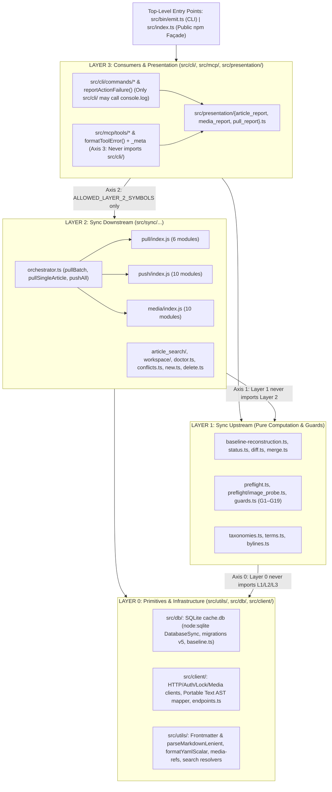

# Architecture, Layering & Infrastructure Specifications

This document is the authoritative specification for Emit's 4-tier architectural layering, workspace filesystem contracts, profile/authentication/origin resolution, local SQLite cache schema, and CLI/MCP presentation symmetry.

---

## 1. 4-Tier Architectural Layering & Dependency Invariants

Emit strictly enforces a unidirectional 4-tier architecture verified statically by `tests/layering.test.ts` and circular dependency checks (`npm run check:cycles` via `madge`).

| Layer | Responsibility & Modules | Allowed Outbound Imports | Allowed Inbound Consumers | Prohibited Imports |
| --- | --- | --- | --- | --- |
| **Layer 0: Primitives & Infra** | `src/utils/`, `src/db/`, `src/client/` — Core types, SQLite cache (`cache.db`, schema migrations in `src/db/migrations.ts`, baseline snapshot reconstruction & `retrackLocalHashOnly` via `src/db/baseline.ts`), HTTP clients, centralized endpoint URL builders (`src/client/endpoints.ts`), media ID branded types (`MediaRecordId`, `StorageKey` in `src/utils/media-id.ts`), taxonomy key helpers (`src/utils/taxonomy-key.ts`), media ref precedence resolver (`src/utils/media-ref-precedence.ts`), search option/date resolvers (`src/utils/search-options.ts`, `src/utils/search-date.ts`), MCP heartbeat (`src/utils/mcp-heartbeat.ts`), and canonical ULID helpers (`src/utils/ulid.ts`). | Layer 0 internals only | Layers 1, 2, 3 | Never imports Layer 1, 2, or 3. |
| **Layer 1: Sync Upstream** | `src/sync/{baseline-reconstruction, status, diff, merge, preflight, guards, taxonomies, terms, bylines}` — Pure computation, baseline spelling reconstruction, status calculation, diff inspection, taxonomy term matching, and preflight safety verification (`src/sync/preflight/image_probe.ts`). | Layer 0 only | Layers 2, 3 | **NEVER imports Layer 2 or Layer 3.** |
| **Layer 2: Sync Downstream** | `src/sync/{orchestrator, push, pull, new, delete, conflicts, doctor, media, article_search, snapshot, workspace}` — Orchestration, remote sync execution, 3-way merge conflict handling, search execution, full-library metadata snapshots, and local file mutations. | Layers 0 and 1 | Layer 3 (strictly restricted to `ALLOWED_LAYER_2_SYMBOLS`) | Never imports Layer 3. |
| **Layer 3: Consumers & Presentation** | `src/cli/`, `src/mcp/`, `src/presentation/` — User interfaces, CLI commands, centralized CLI failure presenter (`src/cli/report-failure.ts`), MCP tools (`withResolvedContext`, `formatToolTextWithMeta` in `src/mcp/tool-errors.ts`), and unified report formatters (`src/presentation/{article_report, media_report, pull_report}.ts`). | Layers 0, 1, and Layer 2 public API symbols | Top-level entry points (`src/bin/emit.ts`, `src/index.ts`) only | Never imported by Layer 0, 1, or 2. |

### Static Enforcement Axes (Axes 0–9)

- **Axis 0 — Layer 0 Outbound Isolation**: Layer 0 (`src/utils/`, `src/db/`, `src/client/`) must never import from Layer 1, Layer 2, or Layer 3.
  - *Layer 0 `node:fs` Scope Exception*: `node:fs` is permitted in Layer 0 for file-based configuration (`utils/config.ts`, `utils/profile.ts`) and article media reference detection (`utils/media-body-refs.ts` via `shouldPreferLegacyRef`), which read workspace files without domain logic.
- **Axis 1 — Layer 1 → Layer 2 Prohibition**: Layer 1 modules must remain side-effect-free and upstream-focused. They must never import Layer 2 modules (`pull`, `push`, `orchestrator`, `delete`, `doctor`, `conflicts`, `new`, `media`, `article_search`, `snapshot`).
- **Axis 2 — Layer 3 → Layer 2 Controlled Access**: Consumers in Layer 3 may only import public API symbols explicitly declared in the `ALLOWED_LAYER_2_SYMBOLS` allowlist in `tests/layering.test.ts`.
- **Axis 3 — Layer 3 Intra-Layer Isolation**: MCP tools (`src/mcp/`) must never import from CLI command modules (`src/cli/commands/`). Shared formatting logic must reside in `src/presentation/`.
- **Axis 4 — Lower Layers → Layer 3 Prohibition**: Layers 0, 1, and 2 (`src/utils/`, `src/db/`, `src/client/`, `src/sync/**`) must never import from Layer 3 (`src/cli/`, `src/mcp/`, `src/presentation/`).
- **Axis 5 — Non-CLI Logging Isolation**: Non-CLI modules (`src/sync/`, `src/utils/`, `src/db/`, `src/client/`, `src/mcp/`, `src/presentation/`) must never write to standard output via `console.log()` or `console.debug()`, preventing JSON-RPC stdio stream corruption for MCP clients. Standard error output (`console.error()`, `console.warn()`) is permitted for diagnostics and warnings. Only `src/cli/` may invoke `console.log()`.
- **Axis 6 — `saveSyncState` Call-Site Isolation**: `.saveSyncState(` may only be called in `src/db/baseline.ts` (`retrackLocalHashOnly`), `src/sync/workspace/commit.ts` (`commitArticleSnapshot`), and `src/sync/conflicts.ts` (`resolveConflict`).
- **Axis 7 — Lenient Frontmatter Parse Isolation**: `gray-matter` may only be imported in `src/utils/frontmatter.ts`, and all inspector/deletion/diff modules (`sync/status.ts`, `sync/doctor.ts`, `sync/conflicts.ts`, `sync/delete.ts`, `sync/diff.ts`, `sync/article_search/local.ts`, `sync/media/body_scan.ts`) must import and use `parseMarkdownLenient()`.
- **Axis 8 — CLI Failure Presenter Isolation**: Every `src/cli/commands/*.ts` module must route action failures through `reportActionFailure()` (`src/cli/report-failure.ts`) or `reportProfileFailure()`.
- **Axis 9 — MCP Tool Error & `_meta` Wrapper Isolation**: Every `src/mcp/tools/*.ts` module must import and use `withResolvedContext()` or `formatToolError()` from `src/mcp/tool-errors.ts`.

### Layer 2 Sibling Coupling & Public Barrel Rules

- **Layer 2 Sibling Snapshot**: Downstream Layer 2 modules must not arbitrarily import sibling Layer 2 modules; shared logic belongs in Layer 0 or Layer 1. The only permitted sibling edges are snapshotted name-by-name in `tests/layering.test.ts`:
  - `orchestrator` → `pull/index.js`, `push/index.js`, `media/index.js` (as the designated Layer 2 coordinator)
  - `doctor` → `conflicts`, `media/index.js`
  - `push/media_stage` → `sync/media/index.js`
  - `pull/media_stage` → `sync/media/index.js`
  - `snapshot/index.ts` → `media/index.js`, `pull/index.js`
- **Public npm Façade Barrels (`src/sync/{pull,push,media}.ts`)**: The top-level thin barrel files `src/sync/pull.ts`, `src/sync/push.ts`, and `src/sync/media.ts` exist strictly for backward compatibility of the public npm façade (`src/index.ts`). **No repository-internal module (across `src/` or `tests/`) may import those barrels**; internal consumers must import directly from `src/sync/pull/index.js`, `src/sync/push/index.js`, or `src/sync/media/index.js`.
- **Governance Rule (Ask First)**: Expanding `ALLOWED_LAYER_2_SYMBOLS` or adding a new Layer 2 sibling coupling edge in `tests/layering.test.ts` requires explicit project owner approval under the Ask First policy.

---

## 2. Workspace Contracts (`src/sync/workspace/`)

Workspace-level filesystem inspection, hashing, and canonical path mutations live in `src/sync/workspace/` (never inside `pull/` or `push/`):

- **`calculateHash(content)` (`src/sync/workspace/hash.ts`)**: Computes the canonical SHA-256 content hash used across `sync_state.local_hash`, `conflict_copy_hash`, and baseline comparisons.
- **`iterWorkspaceArticles(workspaceRoot, collection, options)` (`src/sync/workspace/articles.ts`)**: Single canonical iterator for scanning `<collection>/draft/`, `<collection>/published/`, and optionally `<collection>/conflicts/`. Explicitly parameterized via `{ includeConflicts?: boolean; excludeDeletedBackups?: boolean }` so every scanner (`status`, `doctor`, `conflicts`, `media/pull_library`, `media/prune_protect`, `article_search/local`) declares its boundary contract rather than duplicating `fs.readdirSync` loops.
- **Path & Quarantine Helpers (`src/sync/workspace/index.ts`, `commit.ts`)**: `findLocalFilesByUlid`, `CONFLICTS_SUBDIR`, `isQuarantinedRelativePath`, `resolveCanonicalArticlePath`, and `quarantineLocalCopy`.

---

## 3. Profile, Authentication & Origin Resolution

### 3.1 Multi-Site Profile Registry (`~/.config/emit/profiles.yaml`)

Profiles are stored with `0600` file permissions at `~/.config/emit/profiles.yaml`.

- **Directory-Driven Auto-Detection**: Each profile records its linked `workspace` path. When a CLI command or MCP tool executes inside a workspace (or any nested subdirectory), Emit compares real paths via `resolveDirectoryForComparison()` (`fs.realpathSync` in `src/utils/profile.ts`) so symlinks and trailing slashes never break matching.
- **Ambiguity Safeguard**: Running outside any registered workspace when multiple profiles exist without `--profile` throws `AmbiguousProfileError` instead of guessing.
- **Workspace Link Drift Detection (`detectWorkspaceLinkDrift`)**: When a profile is resolved by origin or explicit flag, but its registered `workspace` path no longer matches the active workspace directory (e.g., after renaming or moving a folder), Emit emits a drift warning and guides the user to re-link via `emit init --profile <name>`. `emit doctor` surfaces the same check as **Check 2b (`Workspace Link Consistency`)**.
- **In-Place Updates & Secret Input (`emit profile set-token`)**:
  - `emit profile add <name> --origin <url>` updates existing profiles in place, preserving existing `token` and `workspace` values unless explicitly overridden (`--token ''` intentionally clears a credential).
  - `emit profile set-token <name>` rotates only the token (`--token` > `--stdin` > interactive TTY prompt with echo disabled). Raw-mode restoration runs both in `finally` and on the stdin `'close'` event so `Ctrl-C` (SIGINT) never leaves the user's terminal in raw mode. Neither old nor new token values are ever printed.

### 3.2 Authentication Resolution Chain & OAuth Auto-Refresh

Authentication credentials resolve in a strict 4-tier priority order (`src/client/auth.ts`):

1. **Environment Variables (`EMDASH_TOKEN` or `EMDASH_API_TOKEN`)**: Highest priority for CI/CD and one-off overrides.
2. **Site Profile Registry (`~/.config/emit/profiles.yaml`)**: Matched via `--profile`, workspace directory auto-detection, unique origin match, single profile, or active fallback.
3. **EmDash CLI Credentials (`~/.config/emdash/auth.json`)**: Fallback when no token is stored on the profile.
4. **Emit Custom Credentials (`~/.config/emit/credentials.json`)**: Final fallback.

**Automatic OAuth Token Refresh on HTTP 401 (`src/client/http.ts`)**:
When resolved credentials carry a `refresh_token` and an API call returns `401 Unauthorized`, Emit automatically requests a new token from `POST /_emdash/api/auth/token` (`grant_type: "refresh_token"`), persists the refreshed token back to `auth.json` when applicable, and retries the request once.

### 3.3 Origin Resolution Precedence (`resolveOriginPriority`)

Both CLI and MCP resolve the target instance `origin` through `resolveOriginPriority()` (`src/cli/context.ts`):

1. **Explicitly selected profile** (`--profile <name>` or MCP `profile: "<name>"`)
2. **`EMDASH_ORIGIN` environment variable** (overrides an implicitly resolved profile for CI/staging overrides)
3. **Auto-resolved profile** (current directory match, unique origin match, or single configured profile)
4. **Resolved auth origin** (carried by `auth.json` / `credentials.json`)
5. **Workspace `.emit/config.json` `origin`** → then `DEFAULT_ORIGIN` (`"https://example.com"`)

- **Source Attribution Invariant**: `loadConfig()` keeps `EMDASH_ORIGIN` in a separate `envOrigin` field and never overwrites the in-memory `config.origin` read from `.emit/config.json`. Whenever a higher-precedence source overrides a lower one, Emit emits a `⚠️ Warning` naming the true source of each value.

### 3.4 Workspace Configuration (`.emit/config.json`) & Git Hygiene

`emit init` creates `.emit/config.json` and `.emit/.gitignore` (`ensureEmitGitignore` in `src/utils/config.ts`):

| Key | Default | Description |
| --- | --- | --- |
| `origin` | `"https://example.com"` | Base URL of the target EmDash instance as persisted on disk. |
| `defaultCollection` | `"posts"` | Default content collection when `--collection` is omitted. |
| `defaultLocale` | `"ja"` | Default locale used when scaffolding new drafts via `emit new` / `sync_new`. |
| `postsSyncLimit` | `30` | Sliding window size per status for batch article pulls (legacy `syncLimit` is also accepted). |
| `mediaSyncLimit` | `100` | Default maximum items fetched by `emit pull-media` and bounded on-demand media resolution walks. |
| `localMediaRefs` | `true` | Default-ON. Rewrites mirrored body image links on disk to article-relative `../../media/<storageKey>` paths. |
| `concurrency` | `8` | Parallel HTTP fetch concurrency during batch pulls. |

- **`.emit/.gitignore` Hygiene**: `initWorkspace()` creates `.emit/.gitignore` covering `cache.db`, `cache.db-wal`, `cache.db-shm`, `cache.db.bak-*`, and `mcp_state.json`. Existing `.emit/.gitignore` files are never overwritten, and Emit never modifies the repository root `.gitignore` (tracking `media/` in Git is the user's decision, per README §6).

---

## 4. Local SQLite Cache Schema (`.emit/cache.db`)

Emit uses Node.js 22+ built-in `node:sqlite` (`DatabaseSync` in `src/db/cache.ts`, zero native C++ addons) with schema migrations managed in `src/db/migrations.ts` (current schema version: **v6**). If a workspace database carries a higher `PRAGMA user_version` than the running binary supports, Emit halts immediately with `[CACHE_SCHEMA_MISMATCH]`.

| Table | Primary Key | Purpose & Key Columns |
| --- | --- | --- |
| `entries` | `id` (ULID) | Caches the latest remote JSON envelope (`raw_json`), collection, slug, status, and raw transport revision (`rev`, Track 1). |
| `base_snapshots` | `id` (ULID) | Stores the last synced baseline for Hybrid 3-Way Merge: `frontmatter_yaml` (**JSON-encoded** `Frontmatter` object holding Layer A canonical percent-encoded taxonomy slugs), `body_markdown` (holding canonical `/_emdash/api/media/file/<storageKey>` URLs), raw transport `rev` (Track 1), and `saved_at` (epoch **seconds**). |
| `sync_state` | `id` (ULID) | Tracks workspace-relative `local_path`, `local_hash` (SHA-256 of disk bytes), `remote_rev` (Track 2 composite comparison key `${version}@draft:${draftRevisionId}` or `${version}@live:${liveRevisionId}`), `last_synced_at`, and pending flags: `conflict_pending`, `body_conflict_pending`, `taxonomy_conflict_pending`, `delete_pending`, `taxonomy_apply_pending`, plus `conflict_copy_path`, `conflict_copy_hash`, `conflict_at`. |
| `bylines` | `id` (ULID) | Caches remote author records (`id`, `slug`, `display_name`, `is_guest`, `updated_at`) synced via `/_emdash/api/mcp` (`byline_list`) during pull. |
| `media_state` | `storage_key` | Schema v5: Tracks offline draft image uploads and mirrored assets keyed by `storage_key` (the immutable public file address). Columns: `storage_key` (PK), `media_id` (D1 record ULID), `local_content_hash` (SHA-256 of local binary), `remote_record_ref` (`media-record:<id>`), `url`, `workspace_path`, `markdown_ref` (storageKey-derived stem), `uploaded_at`, and `status` (`pending` \| `uploaded` \| `ready` \| `failed`). Indexed on `media_id`, `status`, and `local_content_hash`. |
| `snapshot_meta` | `collection` | Schema v6: Tracks full-library metadata snapshot capture timestamp (`captured_at`), article/media counts, taxonomy fetch/reuse counts, and capture duration. |
| `snapshot_articles` | `id` (ULID) | Schema v6: Full-library article metadata & body catalog (`body_source`: `list-live` \| `single-get` \| `list-stale`, `taxonomy_verified`, `comparison_rev`, `categories_json`, `tags_json`) for offline search and 0-GET taxonomy filtering. |
| `snapshot_media` | `media_id` (ULID) | Schema v6: Site-wide (collection-independent) full-library media catalog keyed by `media_id` with nullable `storage_key` for offline `media-search` (skipped when `mirroredOnly` is true; cleared when the last `snapshot_meta` row is cleared). |

---

## 5. CLI & MCP Presentation Symmetry and Error Contracts

- **Shared Presentation Layer (`src/presentation/`)**:
  - `pull_report.ts`: `formatTaxonomySyncFailure`, `formatTaxonomySyncSuccess`, `formatArticleMediaSummary`, `formatPullStatusBreakdown`, `formatPullWindowLabel`. Under partial taxonomy failure, both CLI and MCP follow warning-first semantics (suppressing incomplete success counts while preserving existing local YAML definitions).
  - `article_report.ts`: Shared formatters for single/batch article pull reports, preserved block hints, and `article-search` headers, hits, walk-incomplete notices, and offline framing.
  - `media_report.ts`: Shared formatters for `media-search` headers, hits, hit-limit notices, walk-incomplete notices, tag search hints, and byte size formatting.
- **CLI Failure Presentation (`src/cli/report-failure.ts`)**:
  - Every CLI command action wraps execution and routes errors through `reportActionFailure()` (or `reportProfileFailure()` for profile subcommands), printing a clean `❌ <message>` line (without double-prefixing pre-prefixed `❌` messages) plus structured `[CODE]`, suggestions, and `process.exit(1)`—never dumping raw `file://` stack traces.
- **MCP Tool Error & `_meta` Contract (`src/mcp/tool-errors.ts`)**:
  - Every MCP tool handler must wrap execution (including `resolveContext()`) inside `try/catch` and return `formatToolError(error)` on failure rather than throwing to the MCP SDK (which would strip `[CODE]`, HTTP status, endpoint, `💡 Suggestion`, and `PushValidationError.errors`).
  - Both successful and failed MCP responses attach uniform `_meta` context (`profile`, `workspace`, `origin`, `resolvedBy`) via `formatToolTextWithMeta()`.

---

## 6. Testing & Quality Assurance

- **Dual TypeScript Configuration**:
  - `tsconfig.json`: Compiles `src/` only into `dist/`.
  - `tsconfig.test.json`: Type-checks both `src/` and `tests/` during `npm run typecheck`.
- **Hermetic Environment Isolation (`tests/setup/env-isolation.ts`)**:
  - Wired via Vitest `setupFiles`; clears `EMDASH_ORIGIN`, `EMDASH_WORKSPACE`, `EMDASH_TOKEN`, and `EMDASH_API_TOKEN` before every test file so ambient developer environment variables never leak into test execution.
- **Complete Verification Gate (`npm run check`)**:
  1. `npm run format:check` — Prettier formatting check across `src/**/*.ts` and `tests/**/*.ts`.
  2. `npm run typecheck` — `tsc --noEmit && tsc -p tsconfig.test.json`.
  3. `npm run check:cycles` — `npx --yes madge@8.0.0 --circular --extensions ts src/` (asserts 0 circular dependencies).
  4. `npm test` — Full Vitest suite including `tests/layering.test.ts` (Axes 0–5) and `tests/guards.test.ts` (Rules 1–5).
