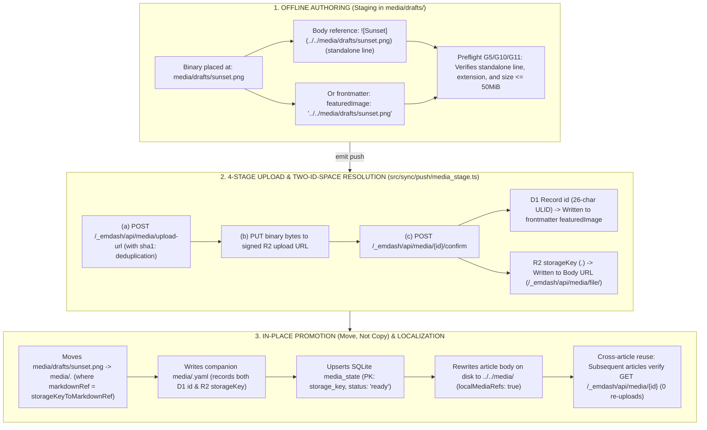

# Local-First Media Pipeline, Mirror Naming & Pruning Specifications

This document specifies Emit's Local-First media pipeline (`src/sync/media/`, `src/sync/pull/media_stage.ts`, `src/sync/push/media_stage.ts`), offline draft image auto-upload (`media/drafts/`), `localMediaRefs` disk localization, `storageKey`-based mirror naming, and remote-authoritative media pruning.

> **Prerequisite Reading**: Read **[docs/media-id-spaces.md](./media-id-spaces.md)** first for the authoritative specification of EmDash's two unrelated media identifier spaces: the D1 media record `id` (`GET /_emdash/api/media/{id}`) vs the R2 `storageKey` (`/_emdash/api/media/file/{storageKey}`).

---

## 1. Architecture of `src/sync/media/`

`src/sync/media/` is organized into 10 focused modules (imported internally via `src/sync/media/index.js`; `src/sync/media.ts` is reserved strictly for the public `src/index.ts` npm façade):

1. **`types.ts`**: Shared interfaces, constants (`MEDIA_BINARY_EXTENSIONS`, `MEDIA_LIST_PAGE_SIZE`, `MEDIA_SEARCH_MAX_LIMIT`), and result shapes (zero runtime functions).
2. **`naming_mirror.ts`**: `mediaMirrorNames()`, `resolveMarkdownRefCollision()`, `mediaRecordIdForStem()`, and duplicate cleanup (`cleanupDuplicateMediaFilesForId`).
3. **`companions.ts`**: Companion `.yaml` serialization, reading, and local mirror metadata indexing.
4. **`mirror_item.ts`**: Single-asset download, SHA-256 verification, legacy filename in-place rename migration, and `media_state` persistence.
5. **`remote_index.ts`**: Bounded and unbounded remote media library walks (`GET /_emdash/api/media`), `RemoteStorageKeyIndex`, and `searchRemoteMedia()`.
6. **`local_search.ts`**: `searchLocalMirrorMedia()` for offline workspace media search (`--offline`).
7. **`body_scan.ts`**: `collectArticleStorageKeys()` — extracts referenced `storageKey`s from Markdown bodies (both standard image links and `<!--ec:block ... -->` opaque fences) and resolves local mirrors.
8. **`pull_article.ts`**: `pullArticleMedia()` — targeted on-demand mirroring for a single article's `featuredImage` and body images.
9. **`pull_library.ts`**: `pullMediaLibrary()` — batch/full media library synchronization, targeted `--storage-key` pulls, and index-based orphan pruning.
10. **`prune_protect.ts`**: Scans workspace articles (`draft/`, `published/`, and `conflicts/`, excluding `.deleted.md` backups) to protect any media asset still referenced locally from being pruned.

---

## 2. Offline Draft Image Auto-Upload & Promotion (`media/drafts/`)

Authors and AI agents can draft articles completely offline by placing new images in `<workspace>/media/drafts/<filename>` and referencing them in Markdown.



### 2.1 Supported Locations & Preflight Guards (G5, G10, G11)

- **Body Images (``)**:
  - Must appear on a **standalone line** (EmDash Portable Text models images as top-level blocks). Inline images inside a paragraph (`Text  more text`) are rejected by Guard **G5 (`INLINE_LOCAL_IMAGE_NOT_SUPPORTED`)**.
  - Must reside under `media/drafts/` (or resolve to an already-promoted asset under `media/`). Arbitrary paths outside `media/` (e.g. `./hero.png`, `/Users/...`) are rejected by Guard **G5 (`LOCAL_IMAGE_DETECTED`)**.
  - Guard **G11 (`LOCAL_IMAGE_AUTO_UPLOAD`)** verifies that the file exists (`MISSING_LOCAL_IMAGE_FILE`), has a supported image extension (`.jpg`, `.jpeg`, `.png`, `.webp`, `.gif`, `.avif`, `.svg`; otherwise `INVALID_LOCAL_IMAGE_TYPE`), and is ≤ 50 MiB (`LOCAL_IMAGE_SIZE_EXCEEDED`).
  - **Code Fence Exemption**: Only backtick code fences (` ``` `) are exempted from G5/G11 image scanning (`FENCE_POLICY.guard`). Tilde fences (`~~~`) are **not** exempted because the Portable Text parser treats tilde fences as normal paragraphs.
- **Frontmatter `featuredImage`**:
  - Accepts a 26-character D1 media record ULID, a local draft image path (`../../media/drafts/cover.jpg`), an already-promoted `media/` path, or `null`.
  - When a local draft image path is provided, `pushArticle` automatically uploads it, resolves its D1 `mediaId`, and writes the canonical 26-character ULID into frontmatter on disk. Guard **G10 (`INVALID_FEATURED_IMAGE`)** rejects invalid paths or malformed IDs before network calls.

### 2.2 The 4-Stage Upload & Promotion Flow (`src/sync/push/media_stage.ts`)

During `emit push` / `sync_push`, each discovered draft image undergoes:

1. **Upload URL Request**: `POST /_emdash/api/media/upload-url` with `sha1:<hex>` content hash for server-side deduplication.
2. **Binary Upload**: `PUT` binary payload to the signed upload endpoint (cleaning up any orphan `pending` record if upload fails midway).
3. **Confirmation**: `POST /_emdash/api/media/{id}/confirm` to finalize the D1 record and obtain the canonical `id` and `storageKey`.
4. **In-Place Promotion (Move, Not Copy)**:
   - The Markdown body reference is rewritten to the canonical `/_emdash/api/media/file/<storageKey>` URL for the remote payload (and localized to `../../media/<storageKey>` on disk if `localMediaRefs: true`).
   - The binary file in `media/drafts/<filename>` is **moved** to `media/<markdownRef>.<ext>` alongside a generated companion `media/<markdownRef>.yaml`, and recorded in `media_state` (`status: 'ready'`). Removing the file from `media/drafts/` keeps the staging directory clean.

### 2.3 Cross-Article Reuse of Already-Promoted Assets

If a second article references the same `../../media/drafts/<filename>` (or directly references `../../media/<markdownRef>.<ext>`):

- Emit resolves the asset through `media_state` and `media/*.yaml` companions (matching the mirror basename or companion `filename:`) instead of re-uploading.
- Before baking the reused URL into the pushed article body, Emit verifies that the record still exists remotely via `GET /_emdash/api/media/{id}`:
  - If the remote record was deleted (HTTP 404), push aborts with `PROMOTED_MEDIA_NOT_FOUND_REMOTE` and purges the stale cache entry.
  - If the server does not implement the single-record endpoint, push proceeds and emits a non-blocking `[MEDIA_EXISTENCE_UNVERIFIED]` warning.

---

## 3. Mirror Naming & Companion Ownership Invariants

### 3.1 StorageKey-Derived Mirror Stem (`storageKeyToMarkdownRef`)

Local mirrors under `media/` are named strictly after the asset's **`storageKey`**, never after its D1 record `id` and never with a `createdAt` date prefix:

- `storageKeyToMarkdownRef(storageKey)` (`src/utils/naming.ts`) takes the basename of the key, strips filesystem-unsafe characters, removes the file extension so `media/<markdownRef>.<ext>` and `media/<markdownRef>.yaml` share the exact same stem, preserves internal dots in multi-ULID keys (`<ulid1>.<ulid2>`), and truncates cleanly on UTF-8 character boundaries.
- **Deterministic Collision Suffix (`collisionSuffixedMarkdownRef`)**: If two distinct media records sanitize to the same `markdownRef` stem, `resolveMarkdownRefCollision()` checks the existing companion `media/<stem>.yaml` `id:`. If owned by a different record, the second asset is named `media/<stem>--<mediaId>.<ext>`. Re-pulling the same record is idempotent and never appends a second suffix.
- **In-Place Legacy Migration**: Workspaces created by older Emit versions hold `media/<yyyyMMdd>_<mediaId>-<name>.<ext>`. When `pull` or `pull-media` encounters a legacy mirror matching a record's `id`, it renames the binary and `.yaml` companion in place to `media/<markdownRef>.<ext>` with zero re-downloading.

### 3.2 Ownership Authority Is Companion YAML Only (`mediaRecordIdForStem`)

A `storageKey`-derived stem frequently starts with a 26-character ULID (the storageKey ULID), which looks syntactically identical to a D1 record `id` ULID.

- **Invariant**: `mediaRecordIdForStem()` reads ownership **exclusively** from the `id:` field inside `media/<stem>.yaml`. It never parses a ULID prefix from a filename. Files in `media/` without a companion `.yaml` cannot be attributed to a remote record and are never touched by pruning or duplicate cleanup.

---

## 4. `localMediaRefs` Disk Localization Invariant

When `localMediaRefs` is `true` (the default in `.emit/config.json`):

1. **Disk Spelling Only**: Mirrored body images (`Track A` plain images) are written to the local Markdown file using article-relative paths (`../../media/<storageKey>` for articles in `<collection>/draft|published/`, computed via `mediaRefPrefixForArticle(relPath) + "media/"`). This enables immediate offline image preview in VS Code, Cursor, and Obsidian.
2. **Canonical Baseline & Remote Payload**: `base_snapshots.body_markdown`, the canonical hash (`calculateHash`), and every remote `PUT`/`POST` payload retain the canonical `/_emdash/api/media/file/<storageKey>` URL. Only `sync_state.local_hash` tracks the localized disk bytes.
3. **Scope Exclusion**: Frontmatter `featuredImage` and Track B `<!--ec:block ... -->` opaque fences are **never** rewritten by `localMediaRefs`; `featuredImage` remains the 26-character D1 record ULID.
4. **Layer 0 Pure Precedence Resolver (`resolveLocalMediaRefsOption` in `src/utils/media-ref-precedence.ts`)**:
   - Resolves explicit CLI/MCP argument over `.emit/config.json` with zero disk I/O.
   - Only the CLI wrapper `resolveAndPersistLocalMediaRefs()` (`src/cli/context.ts`) persists explicit `--local-media-refs` / `--no-local-media-refs` flags to `.emit/config.json`. MCP tools call `resolveLocalMediaRefsOption()` directly and **must never mutate `.emit/config.json`**.

---

## 5. On-Demand Media Mirroring & Pruning Rules

### 5.1 Bounded On-Demand Walks (`MediaMirrorSession`)

- Both batch `emit pull` and single-article `emit pull <id>` automatically mirror referenced media (`featuredImage` and body images) on demand.
- To prevent a single article pull from triggering an unbounded fleet-scale library scan, the shared `MediaMirrorSession` library walk (`GET /_emdash/api/media`), `emit pull-media --article <id>`, and `emit pull-media --storage-key <key>` stop at `mediaSyncLimit` (default `100`).
- **0-HTTP Short-Circuit**: When all storageKeys referenced by an article are already confirmed mirrored on disk (`media_state` or `media/*.yaml`), `pullArticleMedia` verifies them locally with **0 HTTP requests**.
- **Single-GET Featured Image Fast Path**: For a non-batch article that has **no body images** and an unmirrored `featuredImage`, Emit skips the list walk entirely and issues a single `GET /_emdash/api/media/{id}`.

### 5.2 Remote-Authoritative Media Pruning (`pullMediaLibrary`)

`emit pull-media` enables orphan pruning by default (disable via `--no-prune`):

1. **Remote Authority Only**: The active record ID set is seeded **exclusively** from the remote records returned by the `GET /_emdash/api/media` walk—never from a local directory scan (which would make every local mirror self-exempt).
2. **Complete Walk Requirement (`[PRUNE_SKIPPED]`)**: Pruning executes **only** when the remote library walk reached the end of the library (`walkComplete === true`). If the walk stopped at `mediaSyncLimit`, pruning is skipped with `[PRUNE_SKIPPED]` so older assets outside the window are never deleted.
3. **Local Reference Protection (`src/sync/media/prune_protect.ts`)**: Even if a media record was deleted on remote, any local mirror still referenced by an article in `draft/`, `published/`, or a rescue copy in `conflicts/` (excluding `.deleted.md`) is protected from deletion.
