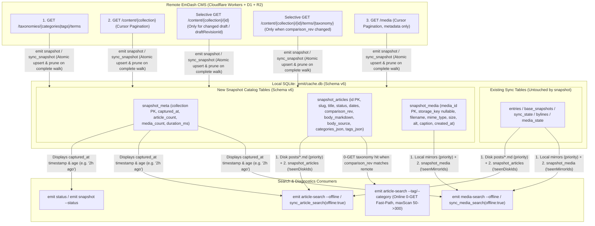

# v0.1.47 実装計画書: リモート全量メタデータ・スナップショット（`emit snapshot` / `sync_snapshot`）とオフライン検索カタログ統合（Rev.3）

- **対象バージョン**: `v0.1.47`
- **作成日**: 2026-11-22（Rev.3: 初回レビュー指摘 A-1〜A-3, B-1〜B-4, C-1〜C-5 に加え、再レビュー残課題 R-1〜R-5 を全件反映）
- **ステータス**: **実装着手可（Approved — オーナー承認済み。Ask First カテゴリ 2・3・4 承認取得済み）**
- **Ask First 該当事項の明示申告**:
  1. **カテゴリ 1（新規 npm パッケージ）**: **非該当（不使用）**。Node.js 22+ 標準の `node:sqlite` (`DatabaseSync`) と既存モジュールのみで完結。
  2. **カテゴリ 2（永続化スキーマ変更）**: **該当（要承認）**。既存の `.emit/cache.db` のスキーマバージョンを **Schema v5 → Schema v6**（`CURRENT_CACHE_SCHEMA_VERSION = 6` in `src/db/migrations.ts`）へ引き上げ、既存 5 テーブル（`entries`, `base_snapshots`, `sync_state`, `bylines`, `media_state`）とは完全に独立したスナップショット専用 3 テーブル（`snapshot_meta`, `snapshot_articles`, `snapshot_media`）を新設する。
  3. **カテゴリ 3（Public Facade / Layering Allowlist / MCP ツール追加）**: **該当（要承認）**。
     - CLI トップレベルコマンド `emit snapshot`（16 → 17 コマンド）および MCP ツール `sync_snapshot`（14 → 15 ツール）を新設。
     - Layer 2 に `src/sync/snapshot/`（`index.ts`, `types.ts`）を新設し、`tests/layering.test.ts` の以下 3 箇所を更新：
       1. `LAYER_2_MODULE_NAMES`: `'snapshot'` を追加
       2. `layer2Dirs`: `path.join(SRC_ROOT, 'sync', 'snapshot')` を追加（※sibling-coupling ゲートの走査対象に必ず含める〔→ B-1〕）
       3. `ALLOWED_LAYER_2_SYMBOLS['snapshot']` および `ALLOWED_LAYER_2_SIBLING_IMPORTS['sync/snapshot/index.ts']`: `new Set(['../pull/index.js', '../media/index.js'])` を明示登録（※`orchestrator.ts` の肥大化を防ぎ、`src/sync/snapshot/index.ts` にオーケストレーションを自己完結させる〔→ B-2〕）
  4. **カテゴリ 4（正典仕様書・AGENTS.md の改訂）**: **該当（要承認）**。`AGENTS.md`、`README.md`、`docs/architecture-and-layers.md`、`docs/sync-engine-and-revisions.md`、`docs/safety-guards-and-diagnostics.md`、`docs/cli-and-mcp-reference.md` に Schema v6 および Epistemic Snapshot Rule（スナップショット取得時刻の明示義務と draft 本文の鮮度整合）を反映。

---

## 0. Rev.1 → Rev.2 改訂サマリ（レビュー指摘への対応表）

| 指摘 ID | 指摘内容 | Rev.2 での解決策（該当セクション） |
|---|---|---|
| **A-1** | **【最重要】リスト API の `item.data.content` は `draft` や `published*`（`draftRevisionId` あり）では作成時の古い `data` または古い `liveData` を返すため、そのまま保存すると Draft Selective Single GET Invariant（`docs/sync-engine-and-revisions.md` §3.2）および Epistemic Rule と矛盾する** | **「Selective Single GET + `body_source` 列による解決」を採用（§3.2, §4.1 Stage 2）**。<br>1. Clean published 記事（`draftRevisionId === null`）はリスト API の `data.content` が最新確定版であるため **0-GET** で変換保存（`body_source = 'list-live'`）。<br>2. `draftRevisionId` を持つ記事または `status === 'draft'` の記事は、まず①ローカル `base_snapshots`（`comparison_rev` 一致時）または②前回 `snapshot_articles`（`comparison_rev` 一致かつ `body_source = 'single-get'`）から **0-GET で確定本文を再利用**し、未キャッシュ／更新済みの場合のみ単体 `GET /content/{collection}/{id}`（1 GET/記事）で最新の確定ドラフト本文を取得（`body_source = 'single-get'`）。単体 GET 失敗時のみ `body_source = 'list-stale'` として記録し検索時に注記する。これにより `comparison_rev` と `body_markdown` の 1:1 対応および Epistemic Rule を 100% 厳守する。 |
| **A-2** | **`snapshot_media` の PK を `storage_key` にすると、`storageKey` が欠落したレコード（record `id` のみ、`tests/media.test.ts:753` / `docs/media-id-spaces.md`）を保存・Prune できない** | **`snapshot_media` の PRIMARY KEY を `media_id TEXT PRIMARY KEY`（D1 26文字 ULID）に変更し、`storage_key TEXT` は nullable（`CREATE INDEX idx_snapshot_media_storage_key`）とする（§3.2）**。これにより全リモートメディアレコードを漏れなく格納でき、リモート record ID 集合による Prune も 100% 整合する。 |
| **A-3** | **`readTaxonomiesFromBaseline()` に `'snapshot-hit'` を足した際の canonicalize 経路と、`ARTICLE_SEARCH_TAXONOMY_MAX_SCAN = 50` の壁が残る問題** | **§6.3 で両方を明記**：<br>(a) `snapshot_articles` の `categories_json` / `tags_json` も `base_snapshots` と全く同じ `canonicalizeTaxonomiesForBaseline(terms, localTaxonomyMaps)` 経路を通してエイリアス照合する（Stage 1 で `pullTaxonomies()` が走るためローカル定義と同期し、万一 snapshot 後にリネームされたタームがあっても `taxonomyTermFilterAliases()` が raw/decoded/canonical/name の全表記を展開して吸収する）。<br>(b) **Taxonomy 検索時の `maxScan` 動的引き上げ**: スナップショットが存在する場合（`cache.getSnapshotMeta(collection) !== null`）、未変更の過去記事は 0-GET で判定できるため、既定 `maxScan` を `50`（`ARTICLE_SEARCH_TAXONOMY_MAX_SCAN`）から通常の記事検索と同じ **`300`（`ARTICLE_SEARCH_DEFAULT_MAX_SCAN`）へ自動的に引き上げる**（かつ HTTP GET 発生回数の安全上限 `MAX_TAXONOMY_REMOTE_FETCHES = 100`〔＝最大 50 記事分の category + tag GET〕ガードを併用〔→ R-3〕）。`walkComplete: false` 時の `[WALK_INCOMPLETE]` 認識論的ルールは一切変更せず維持する。 |
| **B-1** | **`tests/layering.test.ts` の `layer2Dirs` に `sync/snapshot` を追加する記載が漏れている** | **§7.1 に `layer2Dirs` への `path.join(SRC_ROOT, 'sync', 'snapshot')` 追加を明記**し、`sync/snapshot/` 内の全ファイルが sibling-coupling テストで走査されることを保証する。 |
| **B-2** | **実装場所（`orchestrator.ts` vs `src/sync/snapshot/index.ts`）の記述の二者択一** | **`orchestrator.ts`（現 573 行）の肥大化を防ぐため、オーケストレーション本体を `src/sync/snapshot/index.ts` に置き、`ALLOWED_LAYER_2_SIBLING_IMPORTS['sync/snapshot/index.ts'] = new Set(['../pull/index.js', '../media/index.js'])` を Ask First カテゴリ 3 として明示登録する方針に一本化（§4, §7.1）**。 |
| **B-4** | **Fresh DB での Schema v6 初期化テスト、および `VACUUM INTO` バックアップサイズへの配慮** | **§3.2 & §8 Phase 1 に追記**：① Fresh DB（`user_version = 0` → `6`）と既存 v5 DB（`5` → `6`）の両方のマイグレーションテストを追加。② `body_markdown` は検索用プレーン/Markdown テキスト（1 記事平均 5〜15KB、1,000 記事で約 5〜15MB）であり、`pruneBackups()` が最大 3 世代に制限するためディスク圧迫はないが、`--clear` でいつでも `snapshot_*` を空にできる設計とする。 |
| **C-1〜C-5** | **軽微指摘 5 点（`--mirrored-only` 挙動、重複減算後の件数内訳表示、完全走査時のみの原子性 Prune、`snapshot_meta` のスコープ、未取得時の既存フレーミング後方互換）** | **すべて §3.3, §5.2, §6.1, §6.2 に明文化して反映**：特にスナップショット未取得時（`snapshot_meta === null`）のオフライン検索は **既存の `[SOURCE: LOCAL WORKSPACE ONLY (OFFLINE)]` ヘッダーと `buildOfflineArticleSearchFraming()` / `buildOfflineSearchFraming()` の戻り値を 1 バイトも変更せず完全維持**し、既存の全オフライン検索 characterization / framing テストを 100% 保護する〔→ R-4〕。 |
| **R-1〜R-5** | **Rev.2 再レビュー残課題 5 点（§6.2 のオフライン専用スコープ、Taxonomy 再利用時の `taxonomy_verified` 確認、Fetch Cap 定数値 `100` 統一、テスト数表現、`matchedOn` 型不変）** | **すべて §3.2, §4.1(b), §5.2①, §6.2, §6.3 に反映**：特に R-2 対策として `snapshot_articles` に `taxonomy_verified INTEGER NOT NULL DEFAULT 1` 列を設け、前回 taxonomy 取得が失敗（`taxonomy_verified = 0`）または `body_source = 'list-stale'` の行は次回 `comparison_rev` が一致していても 0-GET 再利用せず必ず再取得して自己修復させる。 |

---

## 1. 背景と目的（Why `emit snapshot`?）

### 1.1 背景と課題

1. **Staging Desk 思想（30+30 記事ウィンドウ）とオフライン全量検索のジレンマ**:
   - Emit はローカルワークスペース（`posts/` や `media/`）を軽量・高速に保つため、日常の `emit pull` では直近 30 件（`published` 30 + `draft` 30）の記事と、記事から参照されたメディアのみをディスク上に配置する。
   - 一方で、`emit article-search --offline`（`src/sync/article_search/local.ts`）はディスク上の `posts/{draft,published}/*.md` のみを走査し、`emit media-search --offline`（`src/sync/media/local_search.ts`）はローカルミラー済みの `media/*.yaml` + `media_state` のみを走査する。
   - そのため、フライト中などのオフライン環境で「数年前の過去記事のタイトル・スラッグ・タグ・本文を確認・引用したい」「過去にアップロードした未ミラー画像を検索したい」と思っても、ウィンドウ外の過去資産がオフライン検索に一切ヒットしない。
2. **オンライン時の `--tag` / `--category` 検索における N+1 GET ボトルネック**:
   - リモート記事一覧 API（`GET /_emdash/api/content/{collection}`）のレスポンスには記事ごとの `categories` / `tags` が含まれない。
   - v0.1.44 で導入された `readTaxonomiesFromBaseline()`（`src/sync/article_search/remote.ts:258`）により、ローカルに同期済みの 60 記事は 0-GET で高速判定できるようになったが、**61 件目以降の過去記事は依然として 1 記事あたり最大 2 GET（category + tag）の個別 HTTP リクエストが発生する**ため、`ARTICLE_SEARCH_TAXONOMY_MAX_SCAN = 50` に制限せざるを得なかった。
3. **「いつの時点のデータか」という認識論的安全性（Epistemic Timestamp & Body Freshness Awareness）**:
   - リモート全量のメタデータと本文をローカル DB に取り込む場合、①それが「いつ撮影された断面図（Snapshot）なのか」、②ドラフトや未公開ドラフトリビジョン（`draftRevisionId`）を持つ記事の本文がリスト API の古い `data` / `liveData` ではなく確定した最新リビジョンであるかを厳密に管理しなければ、人間や AI エージェントが古い内容や不在を誤断定（ハルシネーション）する危険がある。

### 1.2 本計画のゴール

1. **同一 `.emit/cache.db` 内への独立スナップショットテーブル新設（Schema v6）**:
   - 既存の `.emit/.gitignore`（`cache.db*` 除外）や単一 `CacheDatabase` インスタンスの利点を 100% 活かしつつ、既存の同期状態（`sync_state`, `base_snapshots`）に一切影響を与えない独立 3 テーブル（`snapshot_meta`, `snapshot_articles`, `snapshot_media`）を新設する。
2. **`emit snapshot` / MCP `sync_snapshot` によるワンショット全量スナップショット＆スマート差分更新**:
   - ワークスペースの `posts/` や `media/` にファイルを 1 つも増やさず、リモート全量の **「① タクソノミー定義 ＋ ② 全記事（メタデータ・抜粋・確定本文 Markdown・カテゴリ・タグ） ＋ ③ 全メディア（全レコードのメタデータ）」** を `.emit/cache.db` に取り込む。
   - **Draft Selective Single GET Invariant の厳守（A-1 対応）**: Clean published 記事はリスト API から 0-GET で本文を取り込み、`draft` および `draftRevisionId` を持つ記事は `comparison_rev` が変化した記事のみ単体 GET で最新本文を確定させる（未変更記事は前回の確定スナップショットまたは `base_snapshots` から 0-GET 再利用）。
   - **2 回目以降の 0-GET 差分更新**: `comparison_rev` が一致する未変更記事は、単体本文 GET もカテゴリ・タグ GET もすべてスキップ（0-GET）するため、2 回目以降は数千記事でも数秒で最新スナップショットへ更新できる。
3. **Epistemic Snapshot Rule（撮影時刻と経過時間の徹底可視化）**:
   - スナップショットが存在するとき、`emit snapshot`、`emit status`、`emit article-search --offline`、`emit media-search --offline` のすべての CLI 出力および MCP 構造化レスポンスに **「スナップショット撮影時刻（`capturedAt` ISO 文字列）と経過時間（`Xh ago` / `Xd ago`）」** を明示し、「その時刻以降のリモートの変更は反映されていない」ことを人間と AI に自覚させる。
4. **オフライン検索（`--offline`）とオンライン Taxonomy 検索 fast-path のカタログ統合**:
   - `--offline` 検索時、ディスク上のローカルファイル（未プッシュ編集を含む最新状態）を最優先しつつ、ディスクに無い過去記事・未ミラーメディアを `snapshot_articles` / `snapshot_media` からシームレスに検索・表示する。
   - オンラインの `emit article-search --tag/--category` 時にも、`base_snapshots` に無ければ `snapshot_articles`（`comparison_rev` 一致時）から 0-GET でタグ・カテゴリを解決し、スナップショット存在時は既定 `maxScan` を `50` → `300` に拡大する。

---

## 2. アーキテクチャ＆データフロー全体図（Mermaid）



---

## 3. 詳細設計 1: SQLite Cache Schema v6（`src/db/migrations.ts`, `src/db/cache.ts`）

### 3.1 なぜ別ファイル（`snapshot.db`）ではなく同一 `.emit/cache.db` か

1. **既存ワークスペースの Git 除外（`.emit/.gitignore`）との 100% 互換性**:
   - `ensureEmitGitignore()`（`src/utils/config.ts:163`）は既存ワークスペースの `.emit/.gitignore` を上書きしない不変条件を持つ。同一 `cache.db` 内にテーブルを追加すれば、既存の `cache.db*` 除外ルールで 100% 確実に保護され、誤コミット事故が起きない。
2. **単一 `CacheDatabase` 接続によるトランザクションとクエリの簡潔性**:
   - `cli/context.ts` や `mcp/server.ts` のコンテキスト解決を一切複雑化させず、`base_snapshots` と `snapshot_articles` の横断参照が単一インスタンスで完結する。
3. **既存 5 テーブルとの完全分離と DB サイズ管理（B-4 対応）**:
   - `emit status` や `emit push --all`、`emit doctor` は `sync_state` とディスク上の `posts/` のみを参照するため、`snapshot_*` テーブルに数千件のレコードが入っても既存の同期・プルーニング・競合判定の挙動は 1 ミリも変化しない。
   - `body_markdown` はテキストのみ（1 記事平均 5〜15KB、1,000 記事で約 5〜15MB）であり、`migrations.ts` の `pruneBackups()` がバックアップを最大 3 世代に自動制限する。また `emit snapshot --clear` でいつでもスナップショット領域を空にできる。

### 3.2 Schema v6 テーブル定義（A-1 `body_source`、A-2 `media_id` PK 反映済み）

`src/db/migrations.ts` の `CURRENT_CACHE_SCHEMA_VERSION` を `5` → `6` に更新し、`runCacheMigrations()` 冒頭の `CREATE TABLE IF NOT EXISTS` ブロックに以下の 3 テーブルを追加する（これにより **新規 Fresh DB（`user_version = 0` → `6`）でも、既存 v5 DB（`user_version = 5` → `6`）からのマイグレーションでも同一定義で確実に作成される**）：

```sql
-- 6. snapshot_meta table: records when the remote metadata snapshot was captured (Schema v6)
-- Note: articles are scoped by collection (e.g. 'posts'), while media is instance-global in EmDash;
-- media_count records the global media snapshot count alongside the target collection's article snapshot.
CREATE TABLE IF NOT EXISTS snapshot_meta (
  collection TEXT PRIMARY KEY,
  captured_at INTEGER NOT NULL,                 -- Epoch milliseconds (Date.now()) when snapshot completed
  article_count INTEGER NOT NULL DEFAULT 0,
  media_count INTEGER NOT NULL DEFAULT 0,
  taxonomy_fetched_count INTEGER NOT NULL DEFAULT 0,
  taxonomy_reused_count INTEGER NOT NULL DEFAULT 0,
  article_single_get_count INTEGER NOT NULL DEFAULT 0,
  duration_ms INTEGER NOT NULL DEFAULT 0
);

-- 7. snapshot_articles table: full-library article metadata & verified body text catalog (Schema v6)
CREATE TABLE IF NOT EXISTS snapshot_articles (
  id TEXT PRIMARY KEY,                          -- 26-char article ULID
  collection TEXT NOT NULL,                     -- e.g. 'posts'
  slug TEXT NOT NULL,
  title TEXT NOT NULL,
  status TEXT NOT NULL,                         -- 'draft' | 'published'
  created_at TEXT,                              -- ISO 8601 string or NULL
  updated_at TEXT,                              -- ISO 8601 string or NULL
  published_at TEXT,                            -- ISO 8601 string or NULL
  comparison_rev TEXT NOT NULL,                 -- Track 2 composite key (${version}@draft:${id} or ${version}@live:${id})
  excerpt TEXT,                                 -- Optional SEO / article excerpt
  body_markdown TEXT NOT NULL DEFAULT '',       -- Converted Markdown body text for offline full-text search
  body_source TEXT NOT NULL DEFAULT 'list-live',-- 'list-live' | 'single-get' | 'list-stale' (A-1 freshness tracking)
  categories_json TEXT NOT NULL DEFAULT '[]',   -- JSON array of canonical category slugs
  tags_json TEXT NOT NULL DEFAULT '[]',         -- JSON array of canonical tag slugs
  taxonomy_verified INTEGER NOT NULL DEFAULT 1, -- 1 when both category & tag terms were confirmed (0 on partial fetch error; R-2)
  captured_at INTEGER NOT NULL                  -- Epoch milliseconds of the snapshot run that verified this row
);
CREATE INDEX IF NOT EXISTS idx_snapshot_articles_collection ON snapshot_articles (collection);
CREATE INDEX IF NOT EXISTS idx_snapshot_articles_status ON snapshot_articles (status);
CREATE INDEX IF NOT EXISTS idx_snapshot_articles_slug ON snapshot_articles (slug);

-- 8. snapshot_media table: full-library media metadata catalog without binary downloads (Schema v6)
-- Primary key is media_id (D1 26-char record ULID) so migrated records lacking a storageKey are
-- still stored and pruned accurately (A-2 / docs/media-id-spaces.md).
CREATE TABLE IF NOT EXISTS snapshot_media (
  media_id TEXT PRIMARY KEY,                    -- D1 26-char media record ULID (canonical record PK)
  storage_key TEXT,                             -- R2 storageKey (nullable for legacy/migrated records without storageKey)
  filename TEXT,
  mime_type TEXT,
  size INTEGER,
  alt TEXT,
  caption TEXT,
  created_at TEXT,                              -- ISO 8601 string or NULL
  captured_at INTEGER NOT NULL                  -- Epoch milliseconds of the snapshot run
);
CREATE INDEX IF NOT EXISTS idx_snapshot_media_storage_key ON snapshot_media (storage_key);
CREATE INDEX IF NOT EXISTS idx_snapshot_media_created_at ON snapshot_media (created_at);
```

### 3.3 `CacheDatabase` 追加メソッドと原子性 Prune 契約（`src/db/cache.ts`, C-3 対応）

- `getSnapshotMeta(collection = 'posts'): SnapshotMetaRecord | null`
- `saveSnapshotMeta(meta: SnapshotMetaRecord): void`
- `getSnapshotArticle(id: string): SnapshotArticleRecord | null`
- `listSnapshotArticles(collection = 'posts'): SnapshotArticleRecord[]`
- `upsertSnapshotArticlesBatch(options: { collection: string; records: SnapshotArticleRecord[]; walkComplete: boolean }): { upserted: number; pruned: number }`
  - **原子性＆Epistemic Prune 契約（C-3）**: `BEGIN TRANSACTION` 内で全レコードを `INSERT OR REPLACE` する。**`options.walkComplete === true` の場合のみ**、同トランザクション内で `DELETE FROM snapshot_articles WHERE collection = ? AND id NOT IN (...)` を実行してリモートで削除された記事を除去する。`walkComplete === false`（途中中断・エラー時）の場合は絶対に Prune を行わない。
- `listSnapshotMedia(): SnapshotMediaRecord[]`
- `upsertSnapshotMediaBatch(options: { records: SnapshotMediaRecord[]; walkComplete: boolean }): { upserted: number; pruned: number }`
  - 同様に `BEGIN TRANSACTION` 内で `media_id` をキーとして一括 Upsert し、**`options.walkComplete === true` の場合のみ** `media_id NOT IN (...)` の古い行を Prune する。
- `clearSnapshot(collection?: string): { articlesCleared: number; mediaCleared: number }`

---

## 4. 詳細設計 2: スナップショット取得エンジン（`src/sync/snapshot/`）

`orchestrator.ts`（現 573 行）の肥大化を防ぐため、Layer 2 に専用ディレクトリ `src/sync/snapshot/`（`index.ts`, `types.ts`）を新設し、オーケストレーションと差分判定をここに自己完結させる（B-2 対応）。

### 4.1 `captureWorkspaceSnapshot()` の 4 ステージ・パイプライン（A-1 Draft Selective Single GET 統合）

ユーザーが `emit snapshot`（または MCP `sync_snapshot`）を実行すると、以下の 4 ステージを順に実行する（`posts/` や `media/` の作業ファイルは一切変更しない）：

1. **Stage 1: タクソノミー定義の最新化（`categories/` & `tags/`）**
   - `pullTaxonomies()`（Layer 1 `src/sync/taxonomies.ts`）を呼び出し、最新のカテゴリ・タグ定義を同期した上で `loadLocalTaxonomyMaps(workspaceRoot)` をロードする。
2. **Stage 2: 全記事のページング走査 ＋ 確定本文解決（A-1） ＋ スマート差分 Taxonomy 解決**
   - `listRemoteArticles()`（`src/sync/pull/list.ts`, `all: true`）を用いて、`published` と `draft` の全記事をカーソル終端までページング取得する。
   - 事前に既存の `cache.listSnapshotArticles(collection)` を `Map<id, SnapshotArticleRecord>` としてメモリにロードしておく。
   - 各記事アイテム（`rawObj`）について、Track 2 の比較用リビジョン `remoteComparisonRev = extractComparisonRev(rawObj, remoteRev)` を算出し、**本文（`body_markdown` / `body_source`）** と **タクソノミー（`categories_json` / `tags_json`）** を以下の規則で解決する：

   #### (a) 本文（`body_markdown` & `body_source`）の解決規則（A-1: Draft Selective Single GET Invariant 準拠）
   EmDash の一覧 API（`GET /content/{collection}`）は、Clean published 記事（`status === 'published' && !rawObj.draftRevisionId`）に対しては最新の `data.content` を返すが、`status === 'draft'` または `Boolean(rawObj.draftRevisionId)`（`published*`）の記事に対しては作成時の古い `data` または公開中の `liveData` しか返さない（`docs/sync-engine-and-revisions.md` §3.2）。
   したがって、`needsSingleGetForBody = isDraft || hasDraftRevision` と定義し、以下の優先順で本文を決定する：

   | ケース | 条件 | 本文の取得元 | `body_source` | 追加 HTTP GET |
   |---|---|---|---|---|
   | **Case 1: Clean Published** | `!isDraft && !hasDraftRevision` | リスト API の `rawObj.data.content` を `portableTextToMarkdown()` で変換 | `'list-live'` | **0-GET** |
   | **Case 2: ローカル同期キャッシュ一致** | `needsSingleGetForBody` かつ `sync_state.remote_rev === remoteComparisonRev` かつ `base_snapshots` 存在 | `base_snapshots.body_markdown` を再利用 | `'single-get'` | **0-GET** |
   | **Case 3: 前回スナップショット一致** | `needsSingleGetForBody` かつ `prevSnapshot.comparison_rev === remoteComparisonRev` かつ `prevSnapshot.body_source === 'single-get'` | `prevSnapshot.body_markdown` をそのまま再利用 | `'single-get'` | **0-GET** |
   | **Case 4: 新規または更新された Draft / `published*`** | `needsSingleGetForBody` かつ上記キャッシュ不一致 | 単体 `GET /_emdash/api/content/{collection}/{id}` を呼び出し、返却された最新確定 `data.content` を変換（`articleSingleGetCount++`） | `'single-get'` | **1 GET** |
   | **Case 5: 単体 GET 失敗時のフォールバック** | Case 4 で単体 GET が非 2xx エラー | リスト API の `data.content`（または空文字）を暫定格納し、鮮度未確定としてマーク | `'list-stale'` | — |

   > **効果**: 通常のブログでは全記事の 90% 以上が Clean Published（Case 1 = 0-GET）であり、残りの Draft / `published*` 記事も 2 回目以降は Case 2 / Case 3（0-GET）で再利用されるため、**通信コストを最小限に抑えながら、ドラフト記事の本文まで 100% 正確な最新リビジョンを保証できる**。

   #### (b) タクソノミー（`categories_json`, `tags_json`, `taxonomy_verified`）の解決規則（R-2 自己修復ガード付き）
   - **優先 1（`base_snapshots` 再利用: 0-GET）**: `sync_state.remote_rev === remoteComparisonRev`（かつ pending フラグなし）かつ `base_snapshots` に `taxonomies` が記録されていれば、`canonicalizeTaxonomiesForBaseline()` で正規化して再利用（`taxonomy_verified = 1`, `taxonomyReusedCount++`）。
   - **優先 2（前回 `snapshot_articles` 再利用: 0-GET）**: `prevSnapshot?.comparisonRev === remoteComparisonRev` **かつ `prevSnapshot.taxonomyVerified === 1` かつ `prevSnapshot.bodySource !== 'list-stale'`** であれば、前回の `categories_json` / `tags_json` を `canonicalizeTaxonomiesForBaseline()` で正規化して再利用（`taxonomy_verified = 1`, `taxonomyReusedCount++`）。（※前回が単体 GET 失敗や terms 取得失敗だった行は `comparison_rev` が同じでもスキップせず優先 3 で再取得し、永久欠落を防止する〔→ R-2〕）。
   - **優先 3（新規・更新・未検証記事のみリモート GET）**: 上記不一致の記事のみ、並列プール（既定 `concurrency: 8`）で `fetchAssignedTerms()`（category + tag）を呼び出す。両方成功時は `taxonomy_verified = 1`、一方でも null（通信失敗）だった場合は `taxonomy_verified = 0` として保存し次回スナップショット時に再試行させる（`taxonomyFetchedCount++`）。

3. **Stage 3: 全メディアのメタデータ走査（バイナリダウンロードゼロ）**
   - `fetchMediaListPage()`（`src/sync/media/remote_index.ts`）を用いて、`GET /_emdash/api/media` をカーソル終端（`!page.nextCursor || page.rawItems.length === 0`）までページング走査する。
   - 各アイテムを `media_id: item.id.toUpperCase()`（PK）、`storage_key: item.storageKey || null` として `upsertSnapshotMediaBatch({ records, walkComplete: true })` で 1 トランザクション保存＆Prune する。
4. **Stage 4: スナップショットメタデータ（`snapshot_meta`）の確定記録**
   - `captured_at = Date.now()`、総記事数、総メディア数、差分統計、所要時間（`duration_ms`）を `snapshot_meta` に保存する。

### 4.2 サブモード：`--status` と `--clear`

- **`emit snapshot`**（デフォルト / MCP `sync_snapshot` with `action: "capture"` or omitted）：Stage 1〜4 を実行して最新スナップショットを撮影し、撮影日時と内訳を表示する。
- **`emit snapshot --status`**（MCP: `sync_snapshot(action: "status")`）：**完全オフライン（0 HTTP）**で現在の `snapshot_meta` を読み取り、撮影日時・経過時間・収録記事数・収録メディア数を表示する。
- **`emit snapshot --clear`**（MCP: `sync_snapshot(action: "clear")`）：**完全オフライン（0 HTTP）**で `snapshot_meta`, `snapshot_articles`, `snapshot_media` を空にし、消去件数を報告する。

---

## 5. 詳細設計 3: 「いつ取り込んだか」を徹底周知する Epistemic Snapshot Rule と後方互換性

### 5.1 経過時間・鮮度フォーマッタ（`src/presentation/article_report.ts` & `media_report.ts`）

- **`formatSnapshotAge(capturedAtMs: number, nowMs = Date.now()): { iso: string; ageLabel: string; ageSeconds: number; isStale: boolean }`**
  - `ageSeconds = Math.max(0, Math.floor((nowMs - capturedAtMs) / 1000))`
  - `ageLabel`: `< 60s` → `"just now"`, `< 3600s` → `"${m}m ago"`, `< 86400s` → `"${h}h ago"`, `>= 86400s` → `"${d}d ago"`
  - `isStale`: `ageSeconds >= 7 * 86400`（7 日以上経過で `true`）

### 5.2 各コマンド・MCP ツールでの表示仕様と既存テスト後方互換（C-2, C-5 対応）

#### ① スナップショット未取得時（`snapshot_meta === null`）の 100% 後方互換保証（C-5, R-4）
- スナップショットが一度も撮影されていない（または `--clear` された）ワークスペースでは、`emit article-search --offline`、`emit media-search --offline`、および `buildOfflineArticleSearchFraming()` / `buildOfflineSearchFraming()` は **現行の出力（`[SOURCE: LOCAL WORKSPACE ONLY (OFFLINE)]`、`source: 'local_workspace'` / `'local_mirrors'`）を 1 文字も変更せずそのまま返す**。
- これにより、既存の全オフライン検索 characterization / framing テストは一切壊れない。

#### ② スナップショット存在時（`snapshot_meta !== null`）のオフライン記事検索出力（C-2 件数内訳の厳密定義）
- `localDiskCount`: ディスク上の `posts/` で走査された記事数（`seenDiskIds.size`）
- `snapshotExtraCount`: `snapshot_articles` のうち `!seenDiskIds.has(row.id)` で追加走査された過去記事数
- `totalSearched = localDiskCount + snapshotExtraCount`
- **ヘッダー出力**:
  ```text
  [SOURCE: LOCAL WORKSPACE + SNAPSHOT @ 2026-11-22T08:35:00.000Z (2h ago)]
  Searched 50 local workspace article(s) + 370 snapshot article(s) (420 total; snapshot captured 2026-11-22T08:35:00.000Z).
  Remote EmDash library was NOT queried live. Changes on remote after the snapshot timestamp are not reflected.
  ```
  *(※`isStale === true` の場合は続けて `⚠️ [STALE_SNAPSHOT] Snapshot is 12d old. Run "emit snapshot" when online to refresh.` を出力)*
- **ヒット行の表示**:
  - ディスク上に実ファイルがある記事（`isLocal: true`）：従来通り `[local: posts/published/...md]`
  - スナップショットのみの過去記事（`isLocal: false, fromSnapshot: true`）：
    - `body_source !== 'list-stale'` の場合：`[snapshot @ 2026-11-22]`
    - `body_source === 'list-stale'` の場合（A-1 単体 GET 失敗フォールバック行）：`[snapshot @ 2026-11-22 | body unverified]`
    - 次行にガイド：`     --> To edit or pull locally: emit pull <id>`

#### ③ スナップショット存在時のオフラインメディア検索出力（C-1 `--mirrored-only` 定義）
- `localMirrorCount`: `collectLocalMirrorIndex()` で見つかったローカルミラー数
- `snapshotExtraCount`: `snapshot_media` のうちローカルミラーに存在しない追加レコード数（ただし **`--mirrored-only` / `mirroredOnly: true` が指定された場合は `snapshotExtraCount = 0` とし、ローカルミラー済み資産のみに絞り込む**〔→ C-1〕）
- **ヘッダー出力**（スナップショット併用時）：
  ```text
  [SOURCE: LOCAL WORKSPACE + SNAPSHOT @ 2026-11-22T08:35:00.000Z (2h ago)]
  Searched 85 mirrored asset(s) + 1165 snapshot media record(s) (1250 total; snapshot captured 2026-11-22T08:35:00.000Z).
  Remote EmDash library was NOT queried live.
  ```
- **ヒット行の表示**:
  - ローカルミラー済み（`mirrored: true`）：従来通り `[mirrored]` + ローカルパス
  - スナップショットのみ（`mirrored: false, fromSnapshot: true`）：`[not mirrored — snapshot @ 2026-11-22]`（`media_id` と `storageKey || '(none)'`、`filename`, `alt`, `caption`, `mimeType`, `size` を表示）

#### ④ `emit status`（および MCP `sync_status`）でのスナップショット鮮度表示
- `emit status` の Summary 行の直下に 1 行表示する：
  - スナップショットあり：`📸 Snapshot: 2026-11-22T08:35:00.000Z (2h ago — 420 articles, 1250 media indexed)`
  - 7 日以上経過時：`📸 Snapshot: 2026-11-10T12:00:00.000Z (12d ago ⚠️ [STALE_SNAPSHOT] — run "emit snapshot" to refresh)`
  - 未取得時：`📸 Snapshot: none (run "emit snapshot" to index full remote metadata for offline search)`

---

## 6. 詳細設計 4: 既存検索パイプラインとの統合詳細（A-3, C-1, C-2 対応）

### 6.1 オフライン記事検索（`src/sync/article_search/local.ts`）

1. `searchLocalArticles(options)`（`options.cache?: CacheDatabase` を受け取る）は、まず `iterWorkspaceArticles()` でディスク上の `posts/draft/`・`posts/published/`（および `includeConflicts` 時は `conflicts/`）を走査し、`seenDiskIds = new Set<string>()` に記事 ULID を記録する。
2. 次に `options.cache` が存在する場合、`const snapshotMeta = options.cache.getSnapshotMeta(collection)` と `const snapshotRows = options.cache.listSnapshotArticles(collection)` を取得する。
3. `snapshotRows` のうち `!seenDiskIds.has(row.id)` の各行に対し、ディスク記事と全く同じフィルタ関数群：
   - `options.status` フィルタ
   - `normalizedSlug` 部分一致
   - `parseArticleDates` / `resolveArticleDateField` / `inArticleDateRange` 日付範囲フィルタ
   - `categories = JSON.parse(row.categoriesJson)` / `tags = JSON.parse(row.tagsJson)` に対する `taxonomyTermMatchesFilter(term, categoryFilterAliases / tagFilterAliases)`
   - `matchesArticleKeyword({ title: row.title, slug: row.slug, excerpt: row.excerpt, body: row.bodyMarkdown }, normalizedQuery)`（ただし `row.bodySource === 'list-stale'` の場合は `body` を検索対象から外し `title / slug / excerpt` のみで判定することで、古い本文による誤ヒットを防止する〔→ A-1〕）
   を適用し、マッチしたものを `hits` に追加して日付降順ソート＆`limit` スライスする。
4. `ArticleSearchResult` にオプショナルな `snapshot?: { capturedAt: number; localDiskCount: number; snapshotExtraCount: number; totalIndexed: number }` を付与する。

### 6.2 オフラインメディア検索（`src/sync/media/local_search.ts` — オフライン経路専用、R-1 & R-5 対応）

> **スコープ明記（R-1）**: `searchLocalMirrorMedia()` は `--offline`（MCP `offline: true`）が指定されたオフライン検索経路でのみ呼び出される（オンラインの `media-search` は `searchRemoteMedia()` を呼び出す）。したがって本節の拡張はオフライン経路のみに作用し、オンラインメディア検索の挙動には影響しない。

1. `searchLocalMirrorMedia(options)` にオプショナルな `cache?: CacheDatabase` と `mirroredOnly?: boolean` を追加する。
2. `options.mirrorIndex`（ローカルミラー済みの `LocalMirrorEntry`）を走査する際、`seenMediaIds = new Set<string>()` と `seenStorageKeys = new Set<string>()` を記録する。
3. `!options.mirroredOnly && options.cache` の場合、`options.cache.listSnapshotMedia()` から `!seenMediaIds.has(row.mediaId) && (!row.storageKey || !seenStorageKeys.has(row.storageKey))` のレコードを取り出し、同じ日付範囲（`sinceBoundary` / `untilBoundary`）およびキーワード（`filename`, `alt`, `caption`, `storageKey`, および `storageKeyToMarkdownRef(row.storageKey)`）フィルタを適用して `hits` にマージする（`mirrored: false, fromSnapshot: true, snapshotCapturedAt: row.capturedAt`）。
   - **`matchedOn` 型不変（R-5）**: `storageKeyToMarkdownRef(row.storageKey)` でマッチした場合は、既存の `MediaSearchHit.matchedOn` ユニオン型（`'filename' | 'alt' | 'caption' | 'storageKey' | 'mirrorStem'`）の `'mirrorStem'`（`storageKey` 直接一致時は `'storageKey'`）に分類する（`remote_index.ts:325-341` と完全同一ロジック）。これにより Layer 3 presentation や MCP ペイロードの `matchedOn` 型変更は不要となる。
4. `MediaSearchResult` にもオプショナルな `snapshot?: { capturedAt: number; localMirrorCount: number; snapshotExtraCount: number; totalIndexed: number }` を付与する。

### 6.3 オンライン記事検索（`src/sync/article_search/remote.ts`）の 0-GET Fast-Path 拡張と `maxScan` 動的拡大（A-3, R-2, R-3 対応）

1. **`readTaxonomiesFromBaseline()` への `'snapshot-hit'` フォールバック追加**:
   - `BaselineTaxonomyRead.reason` のユニオン型に `'snapshot-hit'` を追加する。
   - 既存の 5 前条件（`sync_state` + ディスク未変更 + `base_snapshots`）が `'no-cache'` 等で不成立だった場合、続けて `cache.getSnapshotArticle(itemId)` を参照する。
   - `snapshotRow` が存在し、**`snapshotRow.taxonomyVerified === 1`（R-2）** かつ **`isSameRev(snapshotRow.comparisonRev, comparisonRev)` が真**であれば：
     ```ts
     return {
       terms: {
         categories: JSON.parse(snapshotRow.categoriesJson),
         tags: JSON.parse(snapshotRow.tagsJson),
       },
       reason: 'snapshot-hit',
     };
     ```
     を返す。
2. **正規化（Canonicalize）経路の完全統一（A-3 (a)）**:
   - `executeScanSearch()`（`remote.ts:525-552`）では、`baselineTax.terms` が返った場合（`'cache-hit'` でも `'snapshot-hit'` でも同一）、必ず既存の：
     ```ts
     const canonical = localTaxonomyMaps
       ? canonicalizeTaxonomiesForBaseline(baselineTax.terms, localTaxonomyMaps)
       : baselineTax.terms;
     ```
     を通した上で `taxonomyTermMatchesFilter(c.toLowerCase(), categoryFilterAliases)` で判定する。
   - `categoryFilterAliases` / `tagFilterAliases` は `taxonomyTermFilterAliases()` により raw / decoded / canonicalSlug / display name の全表記に展開されているため、表記揺れやスラッグ変更に対しても安全にマッチする。
3. **スナップショット存在時の Taxonomy `maxScan` 動的引き上げ（A-3 (b), R-3 定数統一）**:
   - 現行 `executeScanSearch()`（`remote.ts:358-360`）は、N+1 GET 爆発を防ぐために `hasTaxonomyFilter` 時のデフォルト `maxScan` を `ARTICLE_SEARCH_TAXONOMY_MAX_SCAN`（`50`）に制限している。
   - 本計画では、**`hasTaxonomyFilter && options.cache?.getSnapshotMeta(collection) !== null` の場合、デフォルト `maxScan` を通常の記事検索と同じ `ARTICLE_SEARCH_DEFAULT_MAX_SCAN`（`300`）に自動的に引き上げる**。
   - **安全弁（Remote Fetch Cap = `MAX_TAXONOMY_REMOTE_FETCHES = 100`）**: 万一スナップショットが古く、300 件の走査中に多数の未キャッシュ新規記事が含まれていた場合に HTTP GET が爆発するのを防ぐため、1 回の検索におけるリモート `fetchAssignedTerms` 呼び出し回数上限を **`MAX_TAXONOMY_REMOTE_FETCHES = 100`**（1 記事あたり category + tag で最大 2 GET のため、未キャッシュ 50 記事分に相当）と定義し、`taxonomyFetchCount >= MAX_TAXONOMY_REMOTE_FETCHES` に達した場合はそこで走査を打ち切り `walkComplete = false`（`[WALK_INCOMPLETE]`）とする安全ガードを併設する。これにより、Epistemic Rule（`walkComplete: false` 時の不在断定禁止）を 100% 守りつつ、スナップショットがある環境では 300 件まで 0-GET で一気にタグ・カテゴリ検索ができる。

---

## 7. レイヤリング・ガード・エラーコード整合性（B-1, B-2 対応）

### 7.1 `tests/layering.test.ts` の更新箇所（Ask First カテゴリ 3）

1. **`LAYER_2_MODULE_NAMES`**:
   - `'snapshot'` を追加（計 10 モジュール）。
2. **`layer2Dirs`（`tests/layering.test.ts:248-255` — B-1 最重要）**:
   - `path.join(SRC_ROOT, 'sync', 'snapshot')` を必ず追加し、`src/sync/snapshot/` 配下の全ファイルが Layer 2 sibling-coupling テストの走査対象に入るようにする。
3. **`ALLOWED_LAYER_2_SYMBOLS['snapshot']`**:
   - `new Set(['captureWorkspaceSnapshot', 'getWorkspaceSnapshotStatus', 'clearWorkspaceSnapshot', 'SnapshotCaptureOptions', 'SnapshotCaptureResult', 'SnapshotStatusResult', 'SnapshotClearResult'])` を追加。
4. **`ALLOWED_LAYER_2_SIBLING_IMPORTS`（B-2）**:
   - `'sync/snapshot/index.ts': new Set(['../pull/index.js', '../media/index.js'])` を追加（`listRemoteArticles` と `fetchMediaListPage` の再利用のため。それ以外の sibling import は一切行わない）。

### 7.2 エラーコード整合性（`tests/guards.test.ts` Rule 2）

- `captureWorkspaceSnapshot()` 内の通信エラーは、既存の `listRemoteArticles()`（`ARTICLE_LIST_FAILED`）、`fetchMediaListPage()`（`MEDIA_LIST_FAILED`）、`pullTaxonomies()`（`TAXONOMY_FETCH_FAILED`）が投げる登録済み `OPERATIONAL_ERROR_CODES` をそのまま透過させるため、未登録の rogue エラーコードは一切発生せず、`tests/guards.test.ts` Rules 1–5 は無変更で green となる。

---

## 8. 実装フェーズとテスト計画

オーナー承認後、以下の 5 フェーズで段階的に実装・検証する：

- **Phase 1: Schema v6 マイグレーションと `CacheDatabase` スナップショット CRUD（Layer 0）**
  - `src/db/migrations.ts`: `CURRENT_CACHE_SCHEMA_VERSION = 6`、`snapshot_meta`, `snapshot_articles`（`body_source` 付き）, `snapshot_media`（`media_id` PK, `storage_key` nullable）の定義。
  - `src/db/cache.ts`: スナップショット CRUD および `walkComplete === true` 時のみのトランザクション Prune 実装。
  - **テスト（`tests/cache.test.ts`）**:
    1. Fresh DB（新規初期化）で直接 Schema v6 の全 8 テーブルが作成されること（B-4）。
    2. 既存 Schema v5 DB から v6 へのマイグレーションが既存 5 テーブルのデータを損なわずに成功すること。
    3. `upsertSnapshotArticlesBatch` / `upsertSnapshotMediaBatch`（`storage_key: null` のレコードを含む、A-2）の Upsert、および `walkComplete: true` 時のみ Prune され `walkComplete: false` 時は Prune されないこと（C-3）。
- **Phase 2: スナップショット撮影エンジン `src/sync/snapshot/`（Layer 2）**
  - `captureWorkspaceSnapshot()` / `getWorkspaceSnapshotStatus()` / `clearWorkspaceSnapshot()` の実装。
  - **テスト（`tests/snapshot.test.ts` 新設）**:
    1. Clean published 記事は 0-GET（`body_source: 'list-live'`）、Draft / `draftRevisionId` 記事は初回のみ単体 GET（`body_source: 'single-get'`）で最新ドラフト本文を取得すること（A-1）。
    2. 2 回目の `captureWorkspaceSnapshot()` で、`comparison_rev` が変わっていない記事は単体 GET も Taxonomy GET もすべて 0-GET でスキップ（再利用）されること。
    3. リモートで削除された記事・メディア（`storageKey` なしレコード含む）が完全走査後にスナップショットから自動除去されること。
- **Phase 3: オフライン検索（`--offline`）とオンライン Taxonomy Fast-Path の統合（Layer 2 & Layer 3 Presentation）**
  - `src/sync/article_search/local.ts`, `src/sync/media/local_search.ts`, `src/sync/article_search/remote.ts`, `src/presentation/article_report.ts`, `src/presentation/media_report.ts` の更新。
  - **テスト（`tests/article_search.test.ts`, `tests/media_search.test.ts`）**:
    1. スナップショット未取得時は既存の `[SOURCE: LOCAL WORKSPACE ONLY (OFFLINE)]` 出力が 100% 維持されること（C-5）。
    2. スナップショット取得後は、ディスク上の 30+30 ウィンドウ外にある過去記事（本文・タグ・日付）および未ミラーの過去メディアが `--offline` でヒットし、ディスク上の同名 ULID 記事と重複しないこと（ディスク優先、C-2）。
    3. `--mirrored-only` 指定時はオフラインメディア検索でスナップショットの未ミラー資産が除外されること（C-1）。
    4. `body_source === 'list-stale'` の行は本文キーワードで誤ヒットせず、`[body unverified]` 注記が出ること（A-1）。
    5. オンラインの `article-search --tag` で、`snapshot_articles` ヒット時に 0-GET で判定され、既定 `maxScan` が 50 → 300 に拡大されること（A-3）。
- **Phase 4: CLI `emit snapshot` / MCP `sync_snapshot` / `emit status` 配線（Layer 3）**
  - `src/cli/commands/snapshot.ts`, `src/mcp/tools/sync-snapshot.ts` の新設と、`src/bin/emit.ts` / `src/mcp/server.ts` / `src/cli/commands/status.ts` / `src/mcp/tools/sync-status.ts` への配線。
  - `tests/layering.test.ts`（`LAYER_2_MODULE_NAMES`, `layer2Dirs`, `ALLOWED_LAYER_2_SYMBOLS`, `ALLOWED_LAYER_2_SIBLING_IMPORTS`）、`tests/cli.test.ts`, `tests/mcp.test.ts`, `tests/mcp_tool_errors.test.ts`, `tests/presentation_symmetry.test.ts` の更新・追加。
- **Phase 5: 正典ドキュメント更新と `npm run check` 最終検証**
  - `AGENTS.md`, `README.md`, `docs/architecture-and-layers.md`, `docs/sync-engine-and-revisions.md`, `docs/safety-guards-and-diagnostics.md`, `docs/cli-and-mcp-reference.md` の更新。
  - `npm run check`（`format:check`, `typecheck`, `check:cycles`, `test`）が 100% green であることを確認。
