# Sync Engine, Revisions, Concurrency & Conflict Resolution

This document specifies Emit's bidirectional synchronization engine (`src/sync/orchestrator.ts`, `src/sync/pull/`, `src/sync/push/`), the Two-Track Revision model, distributed mutual exclusion locks, Hybrid 3-Way Merge, and quarantine conflict resolution (`posts/conflicts/`).

---

## 1. Orchestrator Facades (`src/sync/orchestrator.ts`)

`src/sync/orchestrator.ts` is the designated Layer 2 coordinator that unifies sync workflows across CLI (`src/cli/commands/pull.ts`, `push.ts`) and MCP (`src/mcp/tools/sync-pull.ts`, `sync-push.ts`):

```mermaid
flowchart TD
    subgraph Pull ["PULL PIPELINE & TWO-TRACK REVISION FLOW (src/sync/pull/)"]
        P1["1. Sync Taxonomies (categories & tags) -> derives canPruneTaxonomies"]
        P2["2. List Sliding Window (30+30) or Single GET -> Extract Track 1 (raw _rev) & Track 2 (version@draft:id)"]
        P3{"isSameRev(syncState.remoteRev)?"}
        PFast["0-GET Fast-Path & In-Place Self-Healing (pull/fast_path.ts): Heal legacy media refs, decode %-slugs, lenient YAML repair, 0-GET deleted taxonomy prune"]
        PGet["Draft Selective Single GET: Fetch full draft if hasDraftRevision or tracked draft"]
        PQ["Quarantine local edits to posts/conflicts/*.conflict.md if disk diverged"]
        PSave["Write Layer B Markdown (decoded slugs, ../../media/) & save Layer A base_snapshots"]

        P1 --> P2 --> P3
        P3 -->|"YES (0-GET)"| PFast
        P3 -->|"NO (Remote Changed)"| PGet --> PQ --> PSave
    end

    subgraph Push ["PUSH PIPELINE EXECUTION ORDER (src/sync/push/index.ts)"]
        S1["1. Offline State Guards (push/guards.ts): G12 quarantine check, G15 delete_pending, G17 taxonomy_apply_pending"]
        S2["2. Preflight Stage (push/preflight_stage.ts - BEFORE G16): G2–G11 checks, G6 conflict markers, G9 opaque blocks, G7 title auto-trim"]
        S3["3. Taxonomy Conflict & Plan (guards.ts -> taxonomy_plan.ts): G16 taxonomy_conflict_pending, G4 term resolution, G19 empty wipe guard"]
        S4["4. Draft Media Auto-Upload (push/media_stage.ts - BEFORE article lock): 4-stage upload (upload-url -> PUT -> confirm) or GET verify reused assets"]
        S5["5. Distributed Mutex Lock (client/lock.ts): POST /lock (7-min lease + heartbeat, try/finally release)"]
        S6["6. Pre-PUT Remote Taxonomy Audit & Transport (tax_audit.ts -> transport.ts): Audit live remote terms, PUT article with Track 1 raw _rev + POST /terms"]
        S7["7. Hybrid 3-Way Merge (merge_stage.ts on HTTP 409 / Taxonomy Divergence): Key-by-key frontmatter + Set-based taxonomies + node-diff3 body"]
        S8["8. Local Commit & Finalization (push/commit.ts): Localize body links to ../../media/<storageKey> on disk, keep canonical URLs in base_snapshots, update cache.db"]

        S1 --> S2 --> S3 --> S4 --> S5 --> S6
        S6 -->|"200 OK"| S8
        S6 -->|"409 Conflict or Term Divergence"| S7 --> S8
    end
```



- **`pullBatch()`**:
  1. Synchronizes remote taxonomies (`categories` and `tags`) in a `try/catch` block so taxonomy endpoint errors are contained and reported without aborting article pulls.
  2. Derives `canPruneTaxonomies = !postsOnly && !categoriesFailed && !tagsFailed` (Epistemic Pruning Rule: never auto-prune article frontmatter terms if taxonomy sync was skipped or partially failed).
  3. Fetches the active sliding window of articles (default `postsSyncLimit: 30` per status; when `status: 'all'`, fetches up to 30 `published` + 30 `draft` articles in parallel) and executes `pullArticle()` over a concurrency pool sharing one `MediaMirrorSession`.
  4. Prunes local tracked articles that fell outside the sliding window—aborting with `SyncPruneConflictError` before deleting any file if an out-of-window article (or a duplicate file sharing its ULID) contains unpushed local modifications.
- **`pullSingleArticle()`**:
  1. Optionally refreshes remote taxonomy definitions (preventing stale `INVALID_TAXONOMY_ERROR` or `NOT_FOUND` on newly created terms).
  2. Pulls the targeted article by ULID or file path (even if outside the 30-post sliding window) with on-demand referenced media mirroring.
  3. Optionally runs a bounded media library pass when `includeMedia` is enabled.
- **`pushAll()`**:
  - Scans workspace articles, filters to `modified` and `untracked` files (excluding `invalid` frontmatter files and `posts/conflicts/` rescue copies), and runs `pushArticle()` sequentially.

---

## 2. Modular Pull Pipeline (`src/sync/pull/`)

`src/sync/pull/` is decomposed into 6 focused modules (imported internally via `src/sync/pull/index.js`):

1. **`types.ts`**: Public and internal pull options, result types, `MediaMirrorSession`, and `FastPathContext`.
2. **`list.ts`**: OpenAPI max batch limit discovery, cursor-based pagination (`listRemoteArticles`), and canonical title extraction (`extractCanonicalRemoteTitle`).
3. **`quarantine.ts`**: Quarantine notice formatting (`formatQuarantineNotice`), divergent local copy preservation (`quarantineDivergentLocalCopies`), and 404/410 remote deletion handling (`handleRemoteDeletedArticle`).
4. **`fast_path.ts`**: `tryFastPathOrHeal()` — 0-GET fast-path skip and in-place self-healing when the remote revision has not advanced (`isSameRev === true`):
   - **Legacy depth-free media ref healing**: Re-spells `media/<storageKey>` to article-relative `../../media/<storageKey>` and re-tracks `local_hash` without touching baseline values.
   - **Percent-encoded taxonomy display upgrade**: Re-serializes legacy `%e6...` terms on disk to human-readable decoded CJK (`未分類`).
   - **Lenient frontmatter syntax repair**: Repairs unquoted `%` slugs or indentation errors via `lenientRepairMarkdownFrontmatter()`, re-serializing clean YAML and updating `local_hash`.
   - **0-GET deleted taxonomy term pruning**: When `canPruneTaxonomies` is true and the local file is untouched (`currentDiskHash === existingSync.localHash`), removes taxonomy terms that no longer exist in `categories/` or `tags/`, rewriting both disk and baseline (`bumpBaselineHashOnly: false`) to prevent phantom diffs. If all terms in a taxonomy are removed, `tags: []` is kept so remote orphan relations are cleared on the next push.
   - **Referenced unmirrored media healing**: Mirrors any missing local media files referenced by an otherwise up-to-date article.
5. **`media_stage.ts`**: On-demand referenced media mirroring, shared `MediaMirrorSession` management (library walk bounded by `mediaSyncLimit`, default 100), 0-HTTP short-circuit when all referenced assets are already mirrored locally, in-flight download deduplication across concurrent batch pulls, and `featuredImage` resolution.
6. **`index.ts`**: Top-level `pullArticle()` pipeline coordinator.

---

## 3. Two-Track Revision Invariant & Draft Revisions

EmDash updates `draftRevisionId` (ULID) on draft saves without incrementing `posts.version` or `posts.updatedAt`. Emit prevents HTTP 409 conflict loops on push while ensuring 100% reliable draft change detection on pull by separating revisions into two tracks:

### 3.1 Track 1 (`revForTransport`) vs Track 2 (`revForComparison`)

| Track | Format / Example | Storage Columns | Usage Contract |
| --- | --- | --- | --- |
| **Track 1: Transport Token (`revForTransport`)** | Raw server token (e.g. Base64 `version:updatedAt` or integer string `"3"`) | `base_snapshots.rev`, `entries.rev` | Sent verbatim in `PUT /_emdash/api/content/{collection}/{id}` `{ _rev }` payloads (`push/index.ts` prioritizes `baseSnapshot?.rev` over `syncState?.remoteRev`). **Must NEVER be contaminated with `@draft:` or `@live:` composite suffixes.** For offline `--from-snapshot` restores (`src/sync/pull/snapshot_pull.ts`), `base_snapshots.rev` stores the explicit sentinel `'snapshot:' + comparisonRev` — this prefix is the **sole canonical marker** of a snapshot-derived baseline (`sync_state.remote_rev` holds a standard Track 2 composite key and must never be used to guess snapshot origin). `evaluatePrePreflightGuards` blocks push with `PULL_REQUIRED_BEFORE_PUSH` until an online `pull` confirms `isSameRev` and promotes `base_snapshots.rev` to the live Track 1 token (preserving offline local edits). |
| **Track 2: Comparison Key (`revForComparison`)** | Composite key: `${version}@draft:${draftRevisionId}` or `${version}@live:${liveRevisionId}` | `sync_state.remote_rev` | Stored across all 4 save paths (`pull/index.ts`, `pull/fast_path.ts`, `push/commit.ts`, `push/merge_stage.ts`). Evaluated by `isSameRev()` during pull to detect remote draft saves even when `version` is unchanged. |

- **Presentation Separation (`formatRevForDisplay`)**: Composite suffixes (`@draft:...`, `@live:...`) are stripped in CLI and MCP display outputs (`emit status`, `emit diff`) so users see clean version numbers.

### 3.2 Draft Selective Single GET Invariant

EmDash's list endpoint (`GET /_emdash/api/content/{collection}`) returns stale creation-time `posts.data` for draft articles and published `liveData` for published articles that hold an unpublished `draftRevisionId`.

Therefore, `pullArticle` evaluates:
```ts
const needsFullDraftFetch = hasDraftRevision || (isDraft && Boolean(existingSync));
```
When `needsFullDraftFetch && remoteChanged` (or on initial pull of an untracked article carrying `draftRevisionId`), Emit discards the list item payload and issues a targeted single `GET /_emdash/api/content/{collection}/{id}` to retrieve the canonical draft revision content. Clean published articles (`draftRevisionId === null`) reuse the list payload with zero extra HTTP requests (**0-GET**).

### 3.3 Published Articles with Uncommitted Draft Revisions (`published*`)

In EmDash, a live published article can hold uncommitted draft changes (`status: "published"` with non-null `draftRevisionId`).

- **Single Source of Truth (`hasUncommittedDraftRevision` in `src/utils/draft-revision.ts`)**: Derived strictly from `status === 'published' && sync_state.remote_rev.includes('@draft:')`.
- **No Directory Churn**: The file remains in `posts/published/`.
- **Visual Indicators**:
  - `emit status` displays `🟣 [synced  ] published* <path> [has unpublished draft]`.
  - Disk frontmatter serializes `status: published # draft revision` (`src/utils/disk-spelling.ts`). AI agents and users must not manually edit or remove `# draft revision`; Emit manages it automatically.
- **Push Semantics**:
  - Standard `emit push <file>` stages changes as a remote draft revision on EmDash (omitting `status` in the PUT payload) and preserves `# draft revision`.
  - `emit push <file> --allow-publish` (MCP `allowPublish: true`) publishes the draft revision live to the web and clears `# draft revision` once remote confirms no pending draft revision remains.

---

## 4. Modular Push Pipeline (`src/sync/push/`)

`pushArticle` is decomposed into 10 modules under `src/sync/push/` (imported internally via `src/sync/push/index.js`):

1. **`types.ts`**: Push options, internal stage context, and result types.
2. **`guards.ts`**: Evaluation rails for Guard G12 (`QUARANTINED_COPY_NOT_PUSHABLE`), G15 (`DELETE_PENDING_ARTICLE`), G16 (`TAXONOMY_CONFLICT_PENDING`), and G17 (`TAXONOMY_APPLY_PENDING`).
3. **`preflight_stage.ts`**: Runs `runPreflightChecks` (G2–G11), applies redundant `# Title` auto-trim (G7), and discovers offline draft images in `media/drafts/`.
   - **Evaluation Precedence Invariant**: `runPreflightChecks` (specifically Guard **G6 `UNRESOLVED_CONFLICT_MARKERS`**) is evaluated **strictly before** Guard **G16 (`TAXONOMY_CONFLICT_PENDING`)**, ensuring files with conflict markers in the body receive body-marker instructions rather than taxonomy conflict prompts.
4. **`taxonomy_plan.ts`**: Resolves category/tag slugs and ULIDs against local definitions (`categories/*.yaml`, `tags/*.yaml`) and evaluates Guard **G19 (`DESTRUCTIVE_TAXONOMY_WIPE`)**.
5. **`media_stage.ts`**: Uploads staged offline draft images (`media/drafts/*`), verifies reused promoted assets via `GET /_emdash/api/media/{id}`, rewrites Markdown body links to canonical `/_emdash/api/media/file/<storageKey>` URLs, and promotes local files to `media/<markdownRef>.<ext>`.
6. **`tax_audit.ts`**: Pre-PUT remote taxonomy audit (`auditRemoteTaxonomies`) to detect out-of-band remote taxonomy changes (which do not bump article `version` on EmDash) before sending the article update.
7. **`transport.ts`**: Pure HTTP transport calls for article creation (`POST`), update (`PUT`), taxonomy term synchronization (`POST /terms`), and publish status transitions.
8. **`merge_stage.ts`**: Handles HTTP 409 conflicts and remote taxonomy divergence via Hybrid 3-Way Merge.
9. **`commit.ts`**: Post-push finalization (`pendingFlagsFor` / `PendingFlagsResult`), disk serialization (applying `localMediaRefs` localization on disk while keeping canonical URLs in `base_snapshots`), file relocation on title/status change, and atomic SQLite cache updates.
   - **Flag Symmetry & NULL Rule (`PendingFlagsResult`)**: `conflictCopyPath`, `conflictCopyHash`, and `conflictAt` in `sync_state` are cleared to `NULL` if and only if both `bodyConflictPending === 0` and `taxonomyConflictPending === 0`.
10. **`index.ts`**: Top-level `pushArticle()` pipeline orchestrator, wrapped in the distributed mutex lock lifecycle.

---

## 5. Distributed Concurrency & Hybrid 3-Way Merge

### 5.1 Distributed Mutex Lock Protocol (`src/client/lock.ts`)

Before executing remote mutations in `pushArticle`:

1. Emit requests a distributed lock via `POST /_emdash/api/content/{collection}/{id}/lock`.
2. EmDash grants a **7-minute mutual exclusion lease**.
3. During long pushes (e.g., multiple large draft image uploads), Emit automatically sends periodic lock renewal heartbeats.
4. If another user or agent holds the lock, Emit aborts immediately with `[LOCK_CONFLICT]`, reporting the lock holder identity and lease expiration timestamp.
5. Lock release (`DELETE /lock`) is guaranteed via `try/finally`.

### 5.2 Hybrid 3-Way Merge (`src/sync/merge.ts`)

When a remote article has advanced since the local workspace's `base_snapshots` (detected either via HTTP 409 on PUT or via pre-PUT taxonomy audit):

1. Emit loads three states: **Base** (`base_snapshots`), **Ours** (local working file in canonical Layer A representation), and **Theirs** (latest remote state fetched via single GET).
2. **Frontmatter Field-Level 3-Way Merge**:
   - Scalar fields (`title`, `slug`, `status`, `publishedAt`, `locale`, `featuredImage`, `seo`, `bylines`) are merged key-by-key. If only one side changed a key, that change wins; if both sides changed the same key to different values, a frontmatter conflict is recorded.
   - **Taxonomy Set 3-Way Merge**: Compares Base, Ours, and Theirs term sets. If both sides modified a taxonomy incompatibly, Emit records `taxonomy_conflict_pending = 1` in `sync_state` and blocks subsequent bare pushes under Guard **G16 (`TAXONOMY_CONFLICT_PENDING`)** until resolved via `--resolve-taxonomy <union|local|remote>`.
3. **Markdown Body Line-Level 3-Way Merge**:
   - Executed via `node-diff3`. Non-overlapping edits merge cleanly and are pushed immediately.
   - Overlapping conflicting edits inject standard Git conflict markers (`<<<<<<< LOCAL`, `=======`, `>>>>>>> REMOTE`) into the local file, set `body_conflict_pending = 1`, and abort the push so the author or AI agent can resolve the markers (enforced by Guard **G6** on the next push).

---

## 6. Quarantine Lifecycle (`posts/conflicts/`) & Deadlock Escapes

### 6.1 Divergent Local Content Rescue on Pull (`.conflict.md`)

When `emit pull` encounters a local file whose content hash diverges from `sync_state.local_hash` (unpushed local modifications) and the remote article has also changed (or `--force` is passed):

- Emit moves the divergent local file into `<collection>/conflicts/<filename>.conflict.md` (with a header banner explaining the quarantine) before writing the newly pulled canonical article to `<collection>/draft|published/`.
- **Invariants for Quarantined Rescue Copies**:
  - Never treated as articles by `emit status` (counted separately under `summary.conflicts`) or `emit push --all`.
  - Guard **G12 (`QUARANTINED_COPY_NOT_PUSHABLE`)** blocks pushing any path inside `<collection>/conflicts/` before any network request.
  - Guard **G14 (`QUARANTINED_PATH_REQUIRED`)** restricts `emit conflicts diff` and `emit conflicts resolve` targets strictly to paths inside `<collection>/conflicts/`.
  - Guard **G13 (`CANONICAL_HAS_UNPUSHED_EDITS`)** blocks `emit conflicts resolve <path> --accept-local` if the canonical article itself has accumulated new unpushed edits since the conflict occurred (unless `-f, --force` is passed).
  - Resolving via `--accept-canonical` deletes the rescue copy and calls `cache.clearConflictsByKind(id, 'body')`, unblocking subsequent pushes.

### 6.2 Deletion Rescue Backups (`.deleted.md`) & Pruning

- **`emit delete`**: Before unlinking a local article and deleting its remote record, Emit writes a safety backup to `<collection>/conflicts/<filename>.deleted.md`.
- **`emit conflicts prune`**: Cleans up old `.conflict.md` and `.deleted.md` files (supports `--older-than <duration>` such as `7d` or `24h`, and `--dry-run`). Rescue copies whose canonical article currently has unpushed local edits are automatically skipped. Orphan `.deleted.md` backups (whose canonical article no longer exists) are preserved by default and require `--allow-orphan-rescues` to prune.

### 6.3 Remote-Deleted Article Deadlock Escape (`[REMOTE_ARTICLE_DELETED]`)

If a tracked article is deleted on the remote EmDash server (returning HTTP 404 or 410 during push PUT, conflict GET, or retry PUT), Emit halts with `[REMOTE_ARTICLE_DELETED]` and provides three safe escape routes:

1. **Recreate as a brand-new article**: Remove the `id:` line from frontmatter (or scaffold via `emit new`) and run `emit push <file>`.
2. **Discard local edits and untrack**: Run `emit pull <id> --force`, which quarantines local edits to `<collection>/conflicts/*.local-dropped.md`, removes the canonical file, and purges the SQLite cache entry.
3. **Delete with rescue backup**: Run `emit delete <file> --discard-local-edits` (`--yes`), which saves unpushed edits to `<collection>/conflicts/*.deleted.md` and cleans up local tracking.
