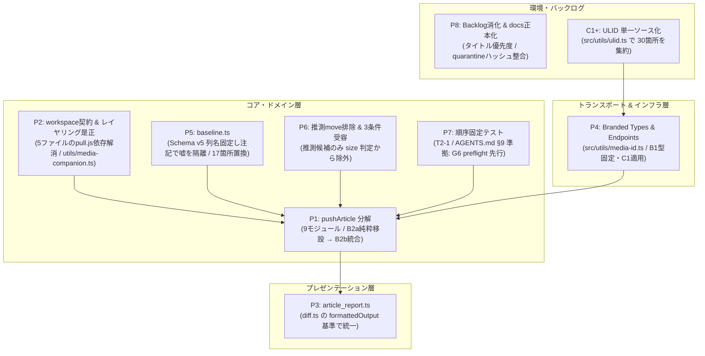
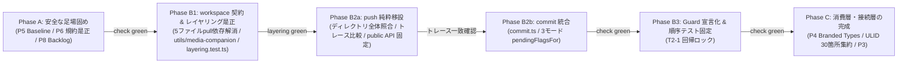

# EMIT 構造化リファクタリング計画書 (v0.1.18+) [確定承認版 Fix-Spec]

> **対象リポジトリ**: `emdash-emit`  
> **起点バージョン / コミット**: `v0.1.17` (HEAD: `5911203`)  
> **テスト健全性**: 40 files / 473 tests green (`npm run check` 通過済み)  
> **文書種別**: 実装基準確定仕様書 (Fix-Spec)  

---

## 1. 概要と背景

v0.1.15 のリファクタ計画 (`docs/v0115-refactor-plan/README.md`) により、Guard Registry（G1–G19）、`src/sync/media/` の 8 モジュール分割、`media-refs.ts` 共通パーサ、Cache Schema v5（`storageKey` 主キー化）が完了しています。

本計画は、EMIT の振る舞い（Behavior）および公開インターフェース・バイナリ規則を 100% 維持したまま、**`pushArticle` の 1,079 行モノリス解消**、**`pull.ts` からのドメイン語彙独立とレイヤリング完全是正**、および **2 重 ID 空間の型安全化** を安全に完遂するための確定仕様です。本書をベースに各タスクを段階的に実装します。

---

## 2. ドメイン不変条件とレイヤリング規則

すべてのリファクタリングは以下の 4 原則を満たす必要があります：

1. **意図の拒否（Guard）と操作の失敗（Operational）の厳格な分離** (`src/sync/guards.ts:36-38`)
2. **人の未反映執筆を絶対に捨てない** (`quarantineLocalCopy`, G13, `conflicts/` 読み取り専用)
3. **分からないことを「無い」と断言しない（Epistemic Rule）** (`walkComplete`, `[UNRESOLVED_MEDIA_ASSET]`)
4. **ディスク表記とリモート Payload の空間分離** (`localMediaRefs` invariant: ベースラインとリモート送信値は常に canonical URL を保持)

### アーキテクチャの公式依存方向と全モジュール層帰属表

```text
[Layer 0: 基盤・ユーティリティ] utils / db / client
        │
        ▼
[Layer 1: Sync 上流（検査・計算）] status / diff / merge / preflight / taxonomies / terms / guards / bylines
        │
        ▼
[Layer 2: Sync 下流（実行・調整）] push / pull / orchestrator / delete / doctor / conflicts / new / media
        │
        ▼
[Layer 3: 外部消費層] cli / mcp / presentation
```

| レイヤ | モジュール一覧 | 責務と依存制約 |
|---|---|---|
| **Layer 0: 基盤** | `src/utils/*`, `src/db/*`, `src/client/*` | 他のレイヤ（1, 2, 3）を import してはならない。`db` → `utils` の参照は許可。**B1 で `storageKeyFromMediaMeta` を `src/utils/media-companion.ts` へ移管**。**Layer 0 での `node:fs` / `node:path` 使用は許可**（既存の `utils/config.js` が fs を使用しており、P2 の移管後もこの方針を維持）。 |
| **Layer 1: Sync 上流** | `status.ts`, `diff.ts`, `merge.ts`, `preflight.ts`, `guards.ts`, `taxonomies.ts`, `terms.ts`, `bylines.ts` | Layer 0 のみ import 可。**Layer 2（下流）および Layer 3 を import してはならない**。Layer 1 内での一方向参照（例: `status` / `diff` の純粋計算）は許可。 |
| **Layer 2: Sync 下流** | `push.ts` (push/*), `pull.ts`, `orchestrator.ts`, `delete.ts`, `doctor.ts`, `conflicts.ts`, `new.ts`, `media/*` | Layer 0, Layer 1 を import 可。オーケストレーション実行・副作用・外部通信を担当。 |
| **Layer 3: 外部消費層** | `src/cli/*`, `src/mcp/*`, `src/presentation/*` | Layer 1 の公開 API、および Layer 2 の **公開エントリポイント（下記スナップショット列挙）**、エラークラス（`instanceof` 用）、Result/Options 型のみを import 可。Layer 2 の内部詳細ヘルパの直接 import は禁止。**Layer 3 内参照（mcp → cli）は当面許可するが P3 で解消**（下記「Layer 3 内参照の規定」）。 |

#### Layer 3 が import を許可される公開 API スナップショット（Layer 1 / Layer 2 混在・実測照合済）

各項目にレイヤタグを付与する。`tests/layering.test.ts` は **Layer 2 語彙のみ**を許可集合として検査し、Layer 1 語彙は「Layer 1 公開 API は自由」条項で許可する（誤って Layer 2 許可集合に登録しないこと）。名前はワイルドカードを使わず実測の完全集合で固定する。

- `[L2] orchestrator`: `pullBatch`, `pushAll`, `SyncPruneConflictError`
- `[L2] push`: `pushArticle`, `PushValidationError`（`PushResult` / `PushOptions` 型は Layer 3 から未使用。`orchestrator.ts` の内部 import のみ）
- `[L2] pull`: `pullArticle`, `formatQuarantineNotice`, `PullResult` 型
- `[L1] status`: `getWorkspaceStatus`, `filterStatusItems`
- `[L1] diff`: `inspectArticleDiff`, `resolveArticleTarget`, `ArticleDiffInspection` 型
- `[L1] taxonomies`: `pullTaxonomies`, `getLocalTaxonomiesSummary`, `formatTaxonomiesHint`
- `[L2] new`: `createArticleScaffold`, `DuplicateSlugError`
- `[L2] delete`: `deleteArticle`, `UnpushedModificationsError`, `PublishedArticleDeletionForbiddenError`（後者の 2 クラスは `mcp/tool-errors.ts:32-33` が import）
- `[L2] conflicts`: `listConflicts`, `diffConflict`, `resolveConflict`, `pruneConflicts`, `CanonicalHasUnpushedEditsError`, `QuarantinedPathRequiredError`（`extractBaseArticleName` / `findCanonicalArticlePath` は Layer 3 から未使用の内部ヘルパ）
- `[L2] doctor`: `runWorkspaceDoctor`
- `[L2] media`: `pullMedia`, `collectLocalMirrorIndex`, `searchRemoteMedia`

#### Layer 3 内参照の規定（P3 まで暫定許可）

- 実測違反: `src/mcp/tools/sync-pull.ts:34` が `formatMediaCoverageLine` / `formatOrphanMediaWarning` を `../../cli/commands/pull.js`（Layer 3 → Layer 3）から import している。
- 層表は同レイヤ内参照を自動検出しないため、`tests/layering.test.ts` の 2 軸検査では捕捉されない。**P3 で新設する `src/presentation/article_report.ts` 経由に集約して解消する**（C2 の検証ゲートに組み込み）。

#### Layer 2 内参照の規定（P2 まで暫定許可）

- 実測参照: `src/sync/media/body_scan.ts:4` が `scanArticleMediaReferences` を `../delete.js`（Layer 2 → Layer 2 兄弟）から import している。
- 方向としては Layer 2 同士のため後述の禁止方向検査（Layer 1 → Layer 2）には抵触しないが、**P2 で `scanArticleMediaReferences` を `src/utils/media-body-refs.ts`（Layer 0）へ移管して兄弟依存を解消**する。

#### 既存レイヤリング違反の是正（B1 完了条件）
1. **`preflight.ts` からの Layer 2 パス import 完全削除**:
   - `src/sync/media/companions.ts:81` の `storageKeyFromMediaMeta`（YAML / URL から storageKey を正規化する純粋関数）を **`src/utils/media-companion.ts`（Layer 0）へ移管**する。
   - `preflight.ts` の import を `'../utils/media-companion.js'` に差し替え、**`./media.js`（Layer 2 パス）への import を完全に削除**する。
   - ※ 移管後に `src/sync/media/companions.ts` 側が `src/utils/media-companion.ts` を import することになるが、これは Layer 2 → Layer 0 であるため完全に許可された依存方向である。
2. **`pull.js` 依存の完全解消（5 ファイル）**:
   - 現行コードで `./pull.js` から語彙（`calculateHash`, `carriesDepthFreeMediaRef`, `CONFLICTS_SUBDIR` 等）を import している **5 ファイル（`status.ts`, `diff.ts`, `conflicts.ts`, `delete.ts`, `doctor.ts`）** を、すべて `src/sync/workspace/` および `src/utils/media-body-refs.ts` 経由に置換する。
   - `pull.ts` は外部後方互換のための re-export のみを残す。
3. **`tests/layering.test.ts` の 2 軸検証ゲート**:
   - **禁止方向の機械検査**: Layer 1（上流）ファイルから Layer 2（下流）パス（`./pull.js`, `./push.js`, `./orchestrator.js`, `./delete.js`, `./doctor.js`, `./conflicts.js`, `./new.js`, `./media.js`, `./media/*`）への import が **0 件** であることを走査検査。
   - **現行許可集合のスナップショット検査**: Layer 3 から Layer 2 への import が上記スナップショットの `[L2]` 項目に収まっていることを検証（`[L1]` 項目は対象外）。

---

## 3. 改善項目（P1〜P8）の詳細仕様



### P1 — `pushArticle` のオーケストレーション分解（9 モジュール設計）
- **分解方針**:
  ```text
  src/sync/push/
    ├── guards.ts          # G12, G15, G16, G17 の評価レール（合否判定のみ）
    ├── preflight_stage.ts # runPreflightChecks 呼び出し、cleanedBody 反映、draftImages 抽出（§5-5 再実装禁止）
    ├── taxonomy_plan.ts   # canonicalizeTerms + resolvedTaxonomies + termId 解決
    ├── media_stage.ts     # uploadAndRewriteDraftImages / finalizePromotedDraftImages / featuredImage 保持
    ├── tax_audit.ts       # PUT 前 remote terms 比較、Divergence 検出（合成 Response を排除し明示的値化）
    ├── transport.ts       # POST create / PUT update / terms POST / publish 遷移（純粋な HTTP 実行）
    ├── merge_stage.ts     # 409 / Divergence → GET remote → hybrid3WayMerge → wipe guard
    ├── commit.ts          # 共通後処理: pendingFlagsFor / serialize → hash → file move → snapshot & syncState
    └── index.ts           # pushArticle 本体（150〜250 行の段組みオーケストレータ）
  ```
  `src/sync/push.ts` は `export * from './push/index.js'` の薄い barrel re-export とし、公開 API を 100% 保証する。

### P2 — ワークスペース契約の集約と media 表記知識の正常化
- **配置方針**:
  - `src/sync/workspace/`: `calculateHash`, `CONFLICTS_SUBDIR`, `isQuarantinedRelativePath`, `quarantineLocalCopy`, `findLocalFilesByUlid`, `resolveCanonicalArticlePath`
  - `src/utils/media-body-refs.ts`: `carriesDepthFreeMediaRef`, `shouldPreferLegacyRef`（メディア表記知識を集約。※将来的に `scanArticleMediaReferences` もここへ移管可能）
    - ※ `shouldPreferLegacyRef` は `fs.readFileSync` / `path.join` を、`carriesDepthFreeMediaRef` は本文走査を使う。Layer 0 への移管に伴い **Layer 0 での `node:fs` 使用を明示的に許可する**ことを §2 層表の Layer 0 条項で規定する（既存の `utils/config.js` も fs を使用する）。
  - `src/utils/media-companion.ts`: `storageKeyFromMediaMeta`（companion パーサを Layer 0 へ集約）
  - `status.ts`, `diff.ts`, `conflicts.ts`, `delete.ts`, `doctor.ts` の 5 ファイルから `./pull.js` import を排除。

### P3 — プレゼンテーション層の統一（基準: `diff.ts` の `formattedOutput`）
- **方針**: `diff.ts` の `formattedOutput` 書式を基準とし、`src/presentation/article_report.ts` を新設。`guards.ts` に `remediationFor(code)` を追加するが、**新規 code は一切増やさず、既存の code（G1〜G19 由来）に対してのみ定義**する。**Layer 3 内参照（`mcp/tools/sync-pull.ts` → `cli/commands/pull.js`）を presentation 経由に集約し解消する**（§2「Layer 3 内参照の規定」）。

### P4 — `SyncCredentials`、Endpoints、および ID 空間 Branded Types
- **方針**:
  - レイヤ逆流（utils → client）を防ぐため、**Branded Types は `src/utils/media-id.ts` に配置**し、`src/client/media-id.ts` はそこから re-export する：
    ```typescript
    export type MediaRecordId = string & { readonly __brand: 'MediaRecordId' };
    export type StorageKey = string & { readonly __brand: 'StorageKey' };
    ```
  - **SyncCredentials の型定義固定は B1** で行い、B2a トレースゲートとの干渉を避ける。**B1 で行うのは基底 interface `SyncCredentials` の追加と `AuthedFetchFactoryOptions`（`client/http.ts:36-43`、全フィールド optional）の `extends` 化のみ**とし、optional/required の切り替え・呼び出し側（`taxonomies.ts`, `bylines.ts`, `pull.ts`, `push.ts` が `origin` / `token` を渡している）の引数適用・段階置換（client → sync/media → sync/article）は **C1** で実施する（B1 での挙動変化をゼロに保つ）。
  - `src/client/endpoints.ts`: 各 API の URL 生成を集約。**返り値型は `string` に完全統一**する。

### P5 — Baseline 復元のカプセル化（Schema v5 列名は固定）
- **方針**:
  - **DB 列名 `frontmatter_yaml` は Cache Schema v5 のまま固定する**（ALTER TABLE は行わない）。
  - `src/db/baseline.ts` を新設し、`/** Despite the column name, this value is JSON-encoded Frontmatter. */` として注記隔離。
  - `readBaseline(snapshot)`、`writeBaseline(id, data)`、`baselineMarkdown(snapshot)` を提供し、`frontmatterYaml` に対する直参照 **17 箇所（parse 9 + stringify 8）** を置換。
  - **byte-identical テスト**: `serializeMarkdown(JSON.parse(frontmatterYaml), bodyMarkdown)` が disk 上の bytes と一致することを `pull` 出力・`push` 書き込みの両方向で検証（`tests/migration_hash_invariants.test.ts`）。

### P6 — 推測 Move（§7 違反）の完全是正と 3 条件受け入れ
- **受け入れ 3 条件（確定版）**:
  1. **推測列挙の削除**: `(f.includes(\`_${item.id}-\`) || f.startsWith(...))` による推測走査を候補から外す。探索は `names.legacyBaseNames`（公式生成規則）＋ `media_state` ＋ companion YAML の `id:`（`naming_mirror.ts:64` の `cleanupDuplicateMediaFilesForId` と同一の metadata 起点方式）へ置換。
  2. **推測候補のみ size 判定から除外（companion-backed の rename は size 一致を維持）**: metadata で属主が確認済みの mirror（`legacyBaseNames` 含む）のリネームは AGENTS.md 許容事項として維持。
  3. **companion 欠損バイナリの不可侵化**: companion が無いバイナリは候補化せず、推測 move も prune も行わない（AGENTS.md §7 準拠）。
  - `push.ts:253-256` の featuredImage cross-check も metadata 起点へ統一し、既存の警告文面テスト（`tests/push_featured_image.test.ts`）を green のまま維持。

### P7 — 順序固定テスト（T2-1 / AGENTS.md §9 準拠）と `PendingFlagsResult` 仕様
- **順序固定テストの設計（既存挙動の完全固定）**:
  - **T2-1 / AGENTS.md §9 の厳格な維持**: `runPreflightChecks`（G6: `UNRESOLVED_CONFLICT_MARKERS` を含む）は、G16（`TAXONOMY_CONFLICT_PENDING`）よりも **確実に先行して評価** される。
  - テスト 1: `taxonomyConflictPending: 1` かつ本文に conflict markers を含む記事を push した際、G16 ではなく G6（`UNRESOLVED_CONFLICT_MARKERS`）が発火することを assert（`tests/sync.test.ts:2995` T2-1 の回帰ロック）。
  - テスト 2: preflight 内部で marker と不正 taxonomy が同時にある場合、G6 が先に発火すること。
- **`pendingFlagsFor` と `PendingFlagsResult` の確定仕様**:
  ```typescript
  export interface PendingFlagsResult {
    conflictPending: number;
    bodyConflictPending: number;
    taxonomyConflictPending: number;
    conflictCopyHash: string | null;
    conflictCopyPath: string | null;
    conflictAt: number | null;
    taxonomyApplyPending: number;
    remoteTaxonomyHash: string | null;
  }

  export function pendingFlagsFor(params: {
    mode: 'create' | 'update' | 'conflict';
    syncState?: SyncState | null;
    hasTaxFailures?: boolean;
    hasBodyConflict?: boolean;
    isTaxonomyConflict?: boolean;
    conflictedHash?: string | null;
    quarantineRelPath?: string | null;
    remoteTaxonomyHash?: string | null;
  }): PendingFlagsResult;
  ```
  - **NULL 規則の固定**: `conflictCopyPath`, `conflictCopyHash`, `conflictAt` は、`bodyConflictPending` と `taxonomyConflictPending` の両方が 0 のときのみ `null` となる。
  - **conflict モード**: 1386 行の `taxonomyApplyPending: 0` を厳格に保持。

### P8 / C1+ — バックログ消化 & ULID 単一ソース化
- **ULID 単一ソース化 (`src/utils/ulid.ts`)**:
  - 12 ファイル / 全 30 箇所の `{26}` パターン（`[0-9A-HJ-NP-Z]{26}` 27 箇所含む）を集約。
  - `isCanonicalUlid()`（厳格な Crockford Base32 26 文字）および `toCanonicalUlid()` を定義。
  - `naming.ts:203` のファイル名抽出用パターン（`[0-9A-Za-z_-]{26}`）は Crockford 制約外を許容するため、**`extractFilenameUlid()` として別関数に分離**。
- **Backlog 消化**: `docs/v0114-backlog.md` 2 件（タイトル解決順序、quarantine ハッシュ整合）の実装とテスト追加。ドキュメント正本化。

---

## 4. 実行フェーズと安全ゲート



### Phase A: 安全な足場固め（低リスク・基盤整備）
| Task ID | 内容 | 検証・ゲート |
|---|---|---|
| **A1** | `src/db/baseline.ts` 新設（列名 `frontmatter_yaml` は v5 のまま固定しコメント隔離）、`frontmatterYaml` 直参照 17 箇所の置換 | `tests/migration_hash_invariants.test.ts` に pull/push 両方向の byte-identical テスト追加 |
| **A2** | P6 ハッシュ関数分離、companion 読み集約、推測 move 排除（3 条件受け入れ、推測候補のみ size 判定から除外、cleanupDuplicateMediaFilesForId 方式準拠） | 「storageKey stem が ULID に酷似する資産」「companion 無し binary」のテスト追加、`push_featured_image.test.ts` green |
| **A3** | P8 `v0114-backlog.md` 2 件（タイトル解決、quarantine ハッシュ）の実装 | 専用ユニットテスト追加 |
| **A4** | P8 `docs/v0115-refactor-plan/` の正本統合、ドキュメント監査 | ドキュメント確認 |

### Phase B: 構造の中心（段階的移設とレイヤリング是正）
| Task ID | 内容 | 検証・ゲート |
|---|---|---|
| **B1** | `src/sync/workspace/` 集約、`carriesDepthFreeMediaRef` は `utils/media-body-refs.ts` へ、`storageKeyFromMediaMeta` は `utils/media-companion.ts` へ移動、`SyncCredentials` 基底 interface 追加 + `AuthedFetchFactoryOptions extends` 化（挙動不変・optional/required 変更なし） | `status, diff, conflicts, delete, doctor` から `./pull.js` import 排除、`preflight.ts` から `./media.js` import 排除、新規 `tests/layering.test.ts` green（Layer 2 許可集合は §2 `[L2]` スナップショットに固定）、既存 13 テスト無変更通過 |
| **B2a** | **push 関数の純粋移設**: private 関数群を `src/sync/push/` 各モジュールへ移設（ロジック変更なし） | **新規 `tests/push_public_api.test.ts`（barrel export 名集合固定）通過**、**`src/sync/push/**/*.ts` ディレクトリ全体での fetch/save/lock 呼び出し総数一致**、**ゴールデントレース比較（HTTP呼び出し・キャッシュ保存順序の一致）**、473 テスト green |
| **B2b** | **commit 共通化 & tax_audit 独立**: `commit.ts`（確定仕様 `pendingFlagsFor` 内包）新設、create/update/conflict 後処理統合、`tax_audit.ts` 独立 | create/update/conflict 対称性アサーションテスト、473 テスト green |
| **B3** | P7 `guards.ts` 順序レール宣言化、`preflight_stage.ts` 並列化 | **T2-1 回帰ロックテスト（G6 先行発火保証）**、`conflict_copy_*` NULL 規則テスト |

### Phase C: 消費側と接続層の品質向上
| Task ID | 内容 | 検証・ゲート |
|---|---|---|
| **C1** | `src/utils/ulid.ts` 集約（30 箇所 / `extractFilenameUlid` 分離）、`src/utils/media-id.ts`（branded types）、`SyncCredentials` 段階適用、`endpoints.ts`（返り値 `string` 統一） | 型チェック通過、API モックテスト通過 |
| **C2** | `diff.ts` の書式を基準に `src/presentation/article_report.ts` 新設、`remediationFor`（新規 code なし）追加、**Layer 3 内参照の解消**: `formatMediaCoverageLine` / `formatOrphanMediaWarning` を presentation 経由に移管 | CLI/MCP 出力対称性テスト（同一結果から同一語彙が出力されること）、`src/mcp/tools/sync-pull.ts` が `../../cli/commands/pull.js` を import しなくなること |
| **C3** | AGENTS.md に Sync 層公式依存方向を追記、全テスト実行 (`npm run check`) | 差分ゼロ確認、最終健全性確認 |

---

## 5. 明示的な非スコープ（やらないこと）

1. **Guard 番号体系（G1–G19）およびエラーコード**: 変更しない。`remediationFor` で新規コードを増やさない。
2. **Cache Schema バージョン**: `v5` のまま固定する（列名 `frontmatter_yaml` は baseline.ts 内で注記隔離し、ALTER TABLE は行わない）。
3. **バイト列不変条件**: `localMediaRefs`、`base_snapshots`、canonical hash の生成バイト列規則は変更しない。
4. **Epistemic Rule**: `walkComplete`、`[UNRESOLVED_MEDIA_ASSET]` 等の認識論的ルールは堅持する。
5. **Preflight 内部の再実装禁止**: 693 行の `runPreflightChecks` は `preflight_stage.ts` から呼び出す形とし、内部ロジックの再実装は行わない。
